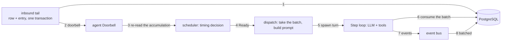

# architecture

> Layering, the channel traits, the event system, the module map. Read before touching cross-module wiring, dependency direction or event persistence.

## Architecture declaration

Layered top-down — `app → platform → agent → agentcore + config + domain`, over `util` / `error` — with dependencies pointing downward. `agentcore` is a core library with no `agent`/`domain`/`config` dependencies, `config` is data plus provider resolution (one reachability probe at startup), `domain` is the data layer, and no platform detail reaches the agent layer except through the channel traits (`agent/channel.rs:Channel` outbound, `ChannelAccess` inbound). No cycle remains: every edge runs downward. Adding an upward dependency is a defect.

### Measured dependencies

```txt
app → platform → agent → agentcore + domain + config
                     ↘  domain → agentcore (the embedding and rerank traits, plus `Language`)
config → agentcore (Language, ModelKind, ProviderKind, Credential, ModelTarget, mcp::McpConfig)
domain → config (the database block) + error
agentcore → util (text) + error
platform → agent + agentcore + config + domain + error
cli → app + agent + agentcore + config + domain + error
error.rs → nothing internal
```

- **`agentcore` names no config type**: the MCP block's own types (`agentcore/mcp.rs:McpConfig`, `McpTransport`) live with the client that reads them, and `agentcore/mcp.rs:McpManager::from_config` takes the `[mcp]` map instead of the whole `AppConfig`, so every cross-edge above is downward — which is what a crate split would need.

Nothing else points upward: the process container lives in `agent/process/context.rs:AppContext` — the lowest layer that can name every one of its parts (config, domain services, agent settings and the event bus) — so only the composition root enters it (`app/mod.rs:serve` for the bot, `cli/mod.rs:Cli::execute` for a management command).

`agentcore` referencing `crate::agent` or `crate::domain` is the one hard prohibition; `crates/hai/tests/layering.rs` asserts it, along with the rest of the table above.

### The channel traits

Two agent-owned traits, the handle the agent acts through, the platform layer's own adapter contract, and two shared pieces:

- `agent/channel.rs:Channel` — what the platform layer implements for one configured channel: its key, its profile, its declaration, and the verbs that act on a chat (send something, start the typing indicator, read a platform file). The agent acts through `agent/channel.rs:ChannelHandle`, which binds one chat to that channel, so no caller re-pairs a chat id with a channel; the outbound vocabulary is `ReplyTo` (where in the chat: topic, reference, quote — where `reference` is an agent-side message id and `quote` narrows it to a part, never a platform value) and `OutboundMessage` (that plus the chat and the payload). A send's receipt (`platform/adapter.rs:SentMessage`/`SentAttachment`) and the adapter's own message types belong to the platform layer, because that layer is their only reader. What the renderer produces is the renderer's own type (`agent/prompt/context/types.rs:BuiltContext`).
- `agent/channel.rs:ChannelAccess` — what the inbound tail and the commands it hands a page to are given: whether a chat may talk to this channel, host copy, a page of buttons and its press, and a file. `platform/adapter.rs:ChannelAdapter` declares it as a supertrait, so the adapter the tail receives provably satisfies it, and no forwarding code exists.
- `platform/adapter.rs:ChannelAdapter` — the platform layer's own contract, implemented once per platform and named by no agent code.
- `platform/outbound.rs:OutboundRecorder` — implements `Channel` over a `ChannelAdapter`: it resolves an internal target to the platform's address, holds the reference to the conversational rules, and records the row that says the message left. An adapter reads no domain rows and holds no process container.
- `agent/inbound/mod.rs:Intake` — the inbound tail, agent-owned because everything it reaches for is agent or domain vocabulary; a platform only reads its own updates into `agent/inbound/arrival.rs:Arrival` and hands it over.
- `platform/host.rs:{ChannelContext, ChannelRuntime}` — one channel as the host holds it: the adapter, the one inbound path, the agents living in its chats, and the token their shutdown hangs on; `ChannelRuntime::assemble` builds all of it from a platform's adapter, so that part is written once.

**The declaration carries only what a reader varies with.** The send tool derives its advertised schema and its runtime validation from `ChannelCapabilities`, and that is what it holds. A field with no reader is not added — a platform's ability to deliver edits, say, is exercised by that platform's arrival mapping, not declared, and whether it shows a typing indicator is not declared either: the platform answers `Channel::start_typing` with the guard or with nothing (`agent/channel.rs:TypingGuard`).

**Platform autonomy**: the agent boundary carries neutral semantics (`ChatType`, `EntryAudience`, the message text and its attachments), and the store keeps that neutral shape — a platform adapter reads its own update into it on the way in (`Arrival`, whose own fields are platform-free: extras ride in `meta`) and reports the same shape on the way out (`SentMessage`). `domain` may carry platform *variants*, but no platform crate types.

## Key data flows

### Platform event to persisted events



The sequence carries the design: **a change is durable before anything is rung** (the row and its accumulation entry land together, so the agent always reads one state); **the scheduler only times** (it owns no side effects and never reads the database); **a Turn is the atomic unit** (the batch it took is consumed only if it ends normally, so a failure needs no repair); and **events are batched out of band**, so auditing never blocks a reply.

### Event system

- `domain/vo/event.rs:AgentEventPayload` is the typed payload enum (serde tag `event`, kebab-case names); `AgentEvent` adds the chat id and — for a model run — its `SessionRef`, and serializes into the table.
- `agent/events/bus.rs:AgentEventBus` buffers emissions and flushes them in batches into the `event` table under the domain `agent`. The table has no chat, kind or session column: all three live inside the JSONB payload, which is what the query indexes are built on (`idx_event_payload_session` serves the prefix scan).
- Two Event semantics matter beyond their names. `ModelRetry{ResponseWithText}` is **not** a retry — it records a speaking-contract violation and the loop continues; only network-class failures, throttling and gateway statuses, and an unparsable response body are actually retried. And the wrap-up events bracket the retention pass, with `WrapUpCompleted` carrying the wrapped chapter's Step count, the pass's own context tokens and its summary; the pass's own session is where those records land.
- `cli/display.rs:tag_for_kind` names the display tag of a payload — an exhaustive `match`, so a new variant fails to compile; the TUI and the `--kind` filter read the same `EventKind::as_str()`, so there is no second hand-written map to keep in step.

### Two HTTP clients

| Path | Client | Why |
|---|---|---|
| Main conversation | genai (`agentcore/provider.rs:create_genai_client`) | multi-provider adaptation, including the adapters for OpenAI-compatible vendors |
| Embedding, speech, multimodal, image generation, rerank | `agentcore::ApiClient` | a small REST client for the tooling endpoints, under the project's own control |

### Errors

One `AppError` enum, no codes or families, boundaries consuming the display string — the shape and its conventions are in `docs/topics/config.md`.

## Module map

| Module | Responsibility |
|---|---|
| app/ | composition root: logging, bot startup and shutdown orchestration |
| platform/ | channel lifecycle host and what it keeps per channel (`platform/host.rs:ChannelContext`), the outbound recorder, and each platform's adapter (the Telegram module: `dispatcher` + `inbound/` — where an update becomes an `Arrival` and where a slash line's owner is decided — `outbound/` (send service, markdown, reply resolution, receipts, typing), `wire/` (the Bot API calls), `ui/` (menu and send forms), plus `builder` and `config`) |
| agent/ | the assistant's own layers, one directory per responsibility: `inbound/` (the arrival and the tail that routes it), `command/` (the slash-command table, its grammar and menu, the dialog engine and the pages `/purge` and `/digest` draw, each with the pass it starts), `chat/` (one chat's agent: state, scheduling, dispatch, its conversation), `run/` (one run of the model: the engine, the Step loop and its record), `events/` (audit bus, doorbell, wake vocabulary), `prompt/` (the role specs, the context rendering and the layer text the model reads), `environment/` (sandbox and workspace), `process/` (the container `agent/process/context.rs:AppContext`, the handles, the registry and the process timers), with `channel.rs`, `settings.rs` and `host_copy.rs` at its root, plus tools, multimodal, the analysis pipeline and networking |
| agentcore/ | core library: tool abstraction, MCP, provider clients, the model-kind table (which protocol each kind speaks), skills, XML rendering |
| domain/ | data layer: models, repos (including the runtime embedding columns), services (the entity facades and the retrieval pipeline), value objects, the chunker, the schema |
| config/ | the configuration schema and its loading, the `[model-roles]` table, provider resolution (with one reachability probe at startup) |
| cli/ | command surface and the event-log TUI |
| util/ error.rs | text helpers and the file cache, the single error type |

## Evolution Direction

- **Startup scan**: reopen chapters that are overdue while idle, with throttling (the interface is left open today).
- **New platform**: a `platform/<name>/` submodule whose adapter implements `platform/adapter.rs:ChannelAdapter` — which includes the inbound half (`agent/channel.rs:ChannelAccess`: admission, host copy, a question with buttons, its in-place rewrite and the answer to a press), so no glue is needed — its declaration, the update stream read into `agent/inbound/arrival.rs:Arrival`, the send calls answering with a `platform/adapter.rs:SentMessage`, deleting messages on the platform, host copy, and file access — plus its own config struct parsed from its `[channel.<name>]` section; one arm in `platform/host.rs:ChannelHost::spawn_all`; and one variant in `domain/model/account.rs:Platform`. Nothing in `agent/` and nothing else in `domain/` changes: admission, the command fork, ingest and the doorbell are the shared tail's (`agent/inbound/mod.rs:Intake`), and the sent row is the shared recorder's.
- **Crate split**: not now — one process and no external consumer of the library surface. Revisit when compile time degrades or a second process needs `domain`/`agentcore` at crate granularity.
- **Deliberately deferred, not to be fixed opportunistically**: the event tag spellings living in three places; a row and its vector still written non-atomically on the perception path (it is a cache and that write is best-effort by design, `docs/topics/domain.md`); and the hand-written JSON keys in the conversation snapshot.
