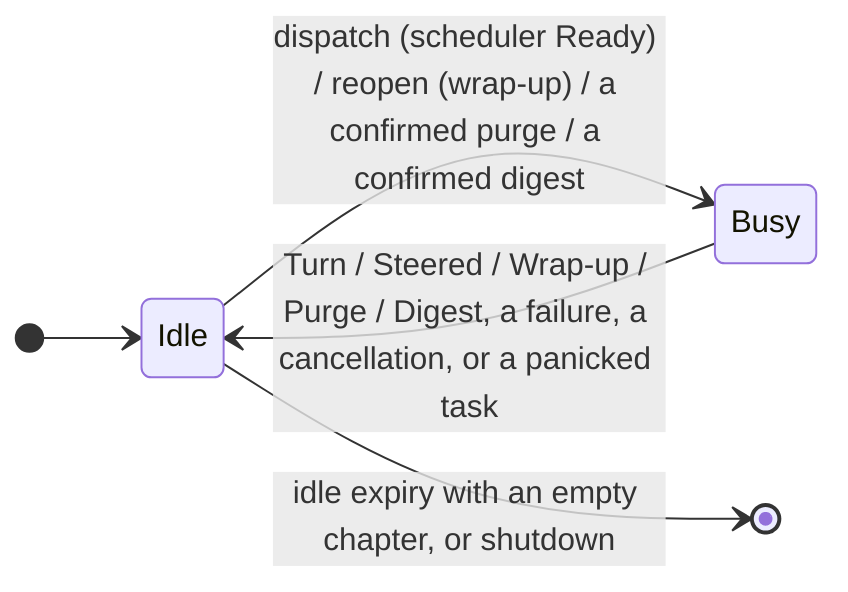

# ChatAgent lifecycle and scheduling

> How a wake becomes a Turn, how a Turn ends, and when the chapter reopens or the environment exits. Read before changing `agent/chat/`, `agent/events/` or `agent/run/engine.rs`. Terms: `docs/CONTEXT.md`; the wake-to-reply sequence is `docs/architecture.md`.

## Overview

One Chat maps to one ChatAgent; this document owns *when a Turn is dispatched and the chapter lifecycle*. The Step loop itself is `agent/run/step_loop/mod.rs` — it runs the model, calls the tools, and reports each thing it did (`StepEvent`) without knowing what an event, a chat or a turn number is. The record layer is `agent/run/record.rs:SessionRecord`: it fills in the chat, the session and the turn and writes the four events; `agent/run/agent_loop.rs:run_loop` builds the loop and installs that recorder, handing the loop a doorbell only when the role asked to be steered.

## Design

### States

`agent/chat/mod.rs:ChatAgentState` is exactly `Idle | Busy { result_rx, started_at, pass }`, and **a Turn, a chapter wrap-up, a purge and a digest are four flavours of Busy** (`agent/chat/mod.rs:BusyPass`; `agent/chat/types.rs:BusySignal` tells their outcomes apart).

### Turn outcomes

A Turn is atomic, and only a normal end advances state. **Success** (the agent stops: `skip`, no more calls, or the Step cap) advances context messages, `ContextMeta`, the consumption of the batch it took and the snapshot together; **Steered** (something arrived mid-Turn) advances the same and starts a new Turn at once; **Failed** (a loop error) advances nothing.

Nothing is partial, so the batch a failed Turn took is still in the accumulation. That is what arms up to two bounded re-dispatches per batch (`agent/chat/mod.rs:MAX_TURN_RETRIES` — three attempts in total, reset by any success or by a fresh change; the attempts left and the instant the owed attempt may go live in `agent/chat/mod.rs:RetryBudget`, cleared where the attempt is dispatched rather than where it is read, and read ahead of the attention rules by `agent/chat/event_loop.rs:ChatAgent::idle_tick`) — otherwise the reply would vanish silently and an unstarted chapter would exit on idle; a failure before the spawn (gathering, prompt build) leaves the batch untouched, counts against the same budget and backs off for a second before the next attempt (`agent/chat/mod.rs:ChatAgent::stand_down`), and a spent budget stands the batch down until a new change reopens it.

### Steering

Steering (`agent/run/agent_loop.rs:run_loop`, enabled per role by `agent/prompt/role/mod.rs:AgentRole::spec`, Default taking `[agent.context] steering`) continues attention instead of preempting it: a Step ending with an arrival since the Turn started ends the Turn as Steered — the doorbell (`agent/events/doorbell.rs:Doorbell::take_signal`) is what the loop checks — what it processed takes effect, and a new Turn starts at once over the accumulation as it now stands, so it reads whatever arrived rather than only what the old Turn had gathered. WrapUp sets `steering = false`, so arrivals wait for after the pass; the record layer hands the loop the doorbell only for a role that asked for one.

### Scheduler

`agent/chat/scheduler.rs:EventScheduler` with `agent/chat/attention.rs:Heat`/`Window` is a pure timing engine, free of the database and the platform. It holds no changes of its own: `ChatAgent::refresh_batch` reads the accumulation, hands each entry it has not seen yet to `EventScheduler::on_event` by its `domain::vo::EntryAudience` — addressed (`Agent`) or a bystander (`Bystanders`) — and `decide` is told whether anything is pending at all. That split drives the rules:

- **Debounce** — a bystander change arms a quiet period, merging a burst into one Turn.
- **Heat** — pending changes plus a lucky roll dispatch probabilistically, letting random attention speak unprompted; nothing pending never dispatches.
- **Attention window** — being addressed, or having spoken itself, opens it and resets heat to maximum; everything pending inside it dispatches. The two openers are named so the paths stay apart (`agent/chat/scheduler.rs:EventScheduler::on_addressed`, `:on_spoke`): a change aimed at the agent also drops a quiet period already running, while the agent's own reply (`agent/chat/dispatch.rs:ChatAgent::on_complete` → `on_spoke`) leaves that quiet period standing — what arrives inside the attention window after a reply dispatches, an overheard burst keeps its debounce.
- **Idle baseline** — only the end of a run moves it (`ChatAgent::end_run` → `EventScheduler::mark_run_end`); no arrival and no attention window does, so a chat that keeps receiving ignored messages still times out.
- **Expiry** — past the idle baseline plus `idle_timeout` the answer is `Done`: end the idle state, never dispatch a backlog whose context is long gone. A backlog is dropped, not lost: the changes stay in the accumulation, and a later Turn reads them.

The Turn that results records the ground it was dispatched on, the batch it read, how many messages the prompt carried (`prompt_messages` — the batch's own, plus the chapter's seed when the chapter opens) and the strongest reason that batch carried (`domain/vo/event.rs:AgentEventPayload::TurnStarted`, `started_by`, `composition`, `prompt_messages` and `reason`; `StartedBy` also carries `Retry` and `Steered`, the two paths that never reach the scheduler). A batch reason alone cannot tell an overheard batch heat let through from one an addressed change opened the attention window for; these two fields can, and they are what `hai log` shows.

### Scheduled wakes

`agent/process/task_watcher.rs:spawn_task_watcher` appends a scheduled entry to the chat's accumulation and rings the agent, exactly as a platform change does; a recurring task advances to its next trigger point, so missed occurrences collapse into one entry, and a one-off task is deactivated (`docs/topics/tools.md`).

### Reopen and wrap-up

The chapter reopens **whether or not the wrap-up succeeds**: the pass runs once, and on success its summary opens the next chapter. At idle, before anything dispatches, two triggers are checked (`agent/chat/event_loop.rs:ChatAgent::idle_tick`): the **token threshold** (the chapter's tokens reach `[agent.context] compact-token-threshold`, 0 disables, checked first so the context cannot outgrow the model window) and **idle expiry** — no run for `[agent.context] session-idle-timeout-secs`, measured from the ChatAgent's last return to Idle, so the attention window plays no part in the deadline (unwrapped content, `ContextMeta.turn_count > 0`, reset by the reopen so it cannot fire twice per chapter; an already-overdue restored agent reopens on its first tick).

The pass (`agent/run/engine.rs:AgentEngine::spawn_wrap_up`) runs as its own session (`wrap-up`, parent = the chapter's session) with one Turn, numbered 1, under the WrapUp role; its retention instruction is appended **as a user message**, its system prompt byte-identical to the Default role's (`agent/prompt/role/mod.rs:AgentRole::spec`). It stops on the first Step with no tool call (`agent/prompt/role/mod.rs:stop_when_no_calls`, shared with the digest), so the model may organize across Steps.

- **Success** — emit `WrapUpCompleted` (the wrapped chapter's Step count, the pass's own context tokens, the summary), open the new chapter with the summary at its head, reset `ContextMeta`; the accumulation is untouched, being conversation-level while the context is chapter-level.
- **Failure** — emit `WrapUpFailed` and open a clean chapter; no retry, no backoff.
- **Extraction** — machine, not conversational: the most recent Step carrying a `
` tag, else the most recent non-empty Step text; only an all-empty pass fails.

### Purge

A `/purge` is confirmed by the host (`agent/command/purge/`) and enqueued as `EntryKind::Purge(PurgeSpec)` — a change like any other, so a restart before it runs reads it and runs it then. It is **not a reason to wake**: `WakeReason::of_entry` answers `None` for it, and a batch that carries no reason at all is one `dispatch` declines to turn.

`agent/chat/event_loop.rs:ChatAgent::idle_tick` intercepts it after `refresh_batch` and **before the scheduler is consulted**: a pending purge whose backoff has passed becomes `NextStep::Purge`, and `start_purge` runs it as a pass of its own (`agent/command/purge/run.rs`). The agent is Busy for its whole length, so an arrival rings the doorbell and waits instead of dispatching a Turn. The scheduler's rules play no part in when it runs; `purge_retry_at` is the only delay it ever takes.

The order inside the pass is settled by what has to be read before it is deleted: the platform ids and the attachment handles come out of rows the wipe is about to remove, so the platform deletion goes first, then the agent surface's rows in one transaction, then the derived data — the event bus is flushed, its rows go, then the transcripts and the cached bytes — and the workspace files last. Purging the agent surface rewrites the conversation row to a clean chapter, because the snapshot holds rendered text and a chapter whose messages went cannot be edited into shape, and consumes every change its own deletes invalidated, plus the confirmed `Purge` entry itself.

Failure reports itself and consumes the entry anyway: a purge that cannot run must not be read again on the next tick. The receipt is host copy (`agent/command/purge/copy.rs`), so nothing of it is stored — the chat reads counts, and each platform refusal is one log line.

### Digest

A `/digest` is confirmed by the host (`agent/command/digest/`) and **writes no chat data at all**: no accumulation entry, no message row, no reply. Its request travels as one in-memory value over the chat's own channel (`agent/chat/handle.rs:ChatAgentRef::request_digest` → `agent/chat/types.rs:DigestRequest`), the report comes back over that request's own reply; a chat agent that drops the request turns the page into a failed page with a retry, while a process restart leaves the buttons stale because no page is persisted.

`ChatAgent::idle_tick` takes it in its own `select` arm (a digest waits for the slot instead of interrupting anything), answers `NextStep::Digest`, and `start_digest` runs the pass with `BusyPass::Digest`. Two things keep it from writing chat data: the tool surface is filtered **before the loop sees it** — only the `AgentTool::reads_only()` tools are mounted, so the schema it is offered is the surface it may use, rather than the full set advertised and then refused at call time the way a wrap-up's is — and the pass has no message row, entry or reply of its own; its steps are traced in its own session (`digest-started` → `step-completed`/`tool-call`/`tool-call-result` → `digest-completed` or `digest-failed`).

The pass (`agent/command/digest/run.rs`) renders the ordinary context **without the conversation** (`agent/prompt/context/sections/context.rs:render_context_for_digest`), writes the window it covers into the task prompt, and reads the window's own rows for one thing only: who spoke in it, so `<accounts>` still names the people the report talks about. The report is the last non-empty Step text (the run spends `[agent] max-steps`, like a Turn), which is why the pass's own contract says the response text is the report (`agent/prompt/role/digest.rs:CONTRACT`); an empty one is a failure the page shows in its own words, a run that spent the ceiling before writing says that rather than claiming it wrote nothing, and a report the cut-off left unfinished says so in the caption it is delivered with.

Delivery is settled before the pass runs: the confirmation page offers the chat and, in a group, the presser's private chat (`agent/command/digest/dialog.rs:Delivery`). The report leaves as a document the moment it is written (`agent/channel.rs:ChannelAccess::notice_document`), with its window as the caption; the dialog page is taken away once the document is there, and a refused removal is only logged. A private-chat delivery sends one queued line first, because a channel cannot edit a message whose id it did not keep. A delivery the platform refuses keeps the report on the page with a retry and the chat itself as a way out, so a pass already paid for is not lost.

### ContextMeta

`domain/vo/context_meta.rs:ContextMeta` holds the last successful Turn's context tokens (the over-limit criterion), the chapter's successful Turn count (what "unwrapped content" means), its Step count (display and the `WrapUpCompleted` payload) and the chapter's session id; Turns are never persisted, and auditing rides on the event table.

### First turn

`agent/chat/conversation.rs:Conversation::is_first_render` is `turn_count == 0`: a chapter with no completed Turn is built whole — a new conversation and either wrap-up outcome alike, the summary a chapter opens with not counting as a Turn — while a chapter that has run one continues incrementally. A failed first Turn stays eligible, failure never advancing the counter.

### The batch

A Turn reads the accumulation through `ChatAgent::gather_batch`: the messages its entries name, deduplicated by message id (a message created and edited in one batch renders once, as the projection now holds it), plus — on a chapter's first render only — the recent history up to `[agent.context] context-seed-cap` that gives them a setting (`domain/service/message.rs:MessageService::recent_asc`). Nothing else about "what is new" is stored: the divider in the rendered conversation comes from the batch's message ids, so a Turn that read nothing has nothing to divide.

Consumption happens once, at a normal end, and in the same statement as the snapshot (`ChatAgent::on_complete` → `ConversationRecordRepo::save`): one insert-or-update, so a first save cannot race the ingest that appends to the same row; the write drops exactly the batch's entry ids, relative to what the accumulation holds by then, so a context and the changes it read can never disagree and an entry appended while the Turn ran stays for the next one. A Failed Turn consumes nothing, which is why the same batch comes back on the retry.

## Boundaries

- ChatAgents are rebuildable; conversations are permanent state.
- Reopen has exactly two triggers and no startup scan: an overdue but idle chat reopens on its next wake.
- A generation start re-feeds (`agent/process/startup_refeed.rs:spawn_startup_refeed`) every chat whose accumulation is unconsumed: a doorbell per chat, never a forced Turn, so an addressed change opens the attention window while a bystander one still waits for heat.
- Exit needs an idle expiry with an empty chapter or the shutdown signal. A Busy agent is cut by that same signal: the run selects on the chat's token (`agent/run/engine.rs:AgentEngine::spawn_busy`), reports `BusySignal::Cancelled`, and consumes nothing, so what it read comes back if the process starts again.
- Turn numbering is session-level: a main session is one chapter, and a wrap-up or a digest numbers its single Turn 1.
- A confirmed purge is a pass of its own, not a Turn: it reads no accumulation entry as a reason and writes no reply into the conversation.
- A purge's writes are the one thing that rewrites conversation state: the row is still never expired on its own, only replaced when what it held was deleted.

## Trade-offs and Reasons

- **Reopening never depends on the wrap-up**: retention is a quality feature and must not block availability, so a failed pass opens a clean chapter instead of retrying.
- **The wrap-up shares the Default prompt and tool surface**: a byte-identical prefix preserves the provider cache, and rejecting `send_*`/`skip` at runtime costs less than a second prompt.
- **A steered Turn keeps its input intact**, so its outcome is applied or discarded whole.
- **Failure discards state instead of repairing it**: consuming only on success is what lets the next Turn retry with no repair path.

## Pitfalls / common mistakes

- **Turn and wrap-up failures differ** (`BusySignal::TurnFailed` vs `WrapUpFailed`): the first keeps Idle with the batch untouched, the second opens a clean chapter. A `Cancelled` run is neither: it ends the run and leaves the state, including a half-wrapped chapter, exactly as it was.
- **`should_wrap_up` asks for unwrapped content**, not message counts; changing it must respect both boundaries (metadata resets, the accumulation preserved).
- **Steering belongs to the Default role only** — interrupt handling in the WrapUp role would break retention.
- **"The agent disappeared" has two causes**: an idle exit with an empty chapter (dropped at once, rebuilt on the next wake) and a creation failure (logged, no agent built).
- **A batch with no wake reason is not a Turn** — `dispatch` returns before it emits anything, and the purge pass is what consumes such a batch. A new entry kind that no Turn should read owes `WakeReason::of_entry` an answer for itself.

## Evolution Direction

- **Unread fetch cap**: a long-offline pile-up can overflow the context; visibility wins for now, truncation by priority is the direction (`docs/architecture.md` owns the startup scan).
