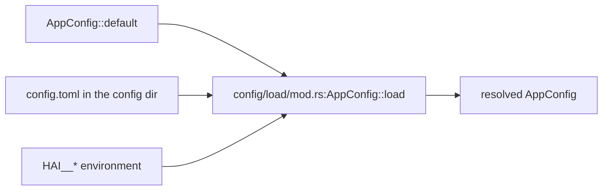

# Config and error handling

> How the config is loaded, where model-role and provider resolution live, Paths, and the error type. Read before changing `config/`, `agent/model/`, `error.rs` or the container in `agent/process/context.rs`.

## Overview

`config` is configuration data plus startup loading; `config/load/mod.rs:AppConfig::load` resolves the sources once at startup into a plain value, `agent/model/` resolves the model roles, the `[models]` catalog and provider availability, and `agent/process/context.rs:AppContext` turns that value into the process context. Nothing writes the config file back and nothing reloads it, so a setting that changes at runtime belongs to the database (`domain/service/preference.rs`) and is reached through `agent/settings.rs:ConversationSettings`, not here.

## Design

### The override chain

`cli/mod.rs:Cli::execute` calls it once, before any command runs, and passes the value down; a missing config file is the defaults, and a parse failure or an unreadable file fails startup.

- **The sources merge key by key.** A key set by a later source wins, every other key keeps its earlier value, and a section no source mentions comes from `AppConfig`'s `Default`. `HAI__MODELS__GEMINI__MAX_TOKENS` therefore leaves the file's other `[models.gemini]` fields alone.
- **Environment naming**: the separator is part of the prefix, so a key must start with `HAI__` (`HAI_MODELS__DEFAULT__MAX_TOKENS` is skipped), and each `__` segment is lowercased and kebab-cased to match `rename_all = "kebab-case"` (`HAI__MODELS__GEMINI__MAX_TOKENS` → `models.gemini.max-tokens`). An unknown `HAI__*` variable fails startup like an unknown file key.
- **`.env`** sits in the config directory (`config/load/paths.rs:Paths::env_file`) and loads before the config file: a missing file skips, a malformed line fails startup, and `dotenvy` never overwrites a set variable — the real environment outranks it.
- **Provider credentials come from a source of their own**: an unprefixed variable is read at provider resolution, not by config-rs, and it outranks the file's `api-key` (`agent/model/provider.rs:ProviderRegistry::discover`; see *Provider availability*). The first candidate is the variable the provider's own name derives — `[providers.my-gateway]` reads `MY_GATEWAY_API_KEY`, upper-cased with anything but an ASCII alphanumeric becoming `_` — and the variable its kind shares (`OPENROUTER_API_KEY`, `GEMINI_API_KEY`/`GOOGLE_API_KEY`, …) is the fallback. A provider whose name is its kind's own spelling (`[providers.google]`) derives nothing, so the kind's order stands (`GEMINI_API_KEY` before `GOOGLE_API_KEY`).

### Paths

Every path derives from `config/load/paths.rs:Paths::inferred()`, resolved once per process (`OnceLock`). `.hai/` wins when it exists or `HAI_LOCAL_MODE` is set (presence alone, the value is ignored), otherwise the XDG directories.

### Model roles

`[models.<alias>]` is the one declaration of a provider model: `model` as `provider/model` (the first `/` splits provider from model id, so OpenRouter ids keep their later slashes), optional display `name`, `roles`, `input`, `max-tokens`, `context-window`, `temperature`, `thinking` and `pricing`; the preset is optional when a role selector is a direct `provider/model`. `roles` defaults to `["chat"]` and `input` to `["text"]`; a model may declare `roles = ["chat"]` and `input = ["text", "image"]` for native image input without offering the auxiliary `vision` role. `max-tokens` is the per-response output cap, `context-window` is the total prompt-plus-completion capacity (not sent on the wire), and `temperature` is a model default that `[model-roles.default].temperature` may override; when neither is set, no temperature is sent. `pricing` is USD per 1M tokens for display; no billing arithmetic uses it.

`[model-roles]` then selects a model per ModelRole, and each block keeps only its own values — `speech`'s `voice`/`speed`, `embedding`'s `dimension`. A model's `roles` only adds it to the candidate pool; an absent role block turns the role off. A block with an empty alias selects the only configured model that declares the role, and more than one candidate fails startup with its aliases. `roles` on the model entry stays explicit: a provider model id does not prove capabilities, and it is the declarative surface auto-selection and role validation read. The environment spells the alias: `HAI__MODEL_ROLES__DEFAULT__MODEL=gemini`. `[model-roles.default]` is required and defines the chat role; an empty alias selects the only chat candidate, and no candidate fails startup. A Conversation may carry a stored model preference; without one it uses this role. A role never names `base-url`; the model entry's provider owns the endpoint. How HAI behaves around a model is not here: the analysis switches and templates are `[agent.multimodal]`, the retrieval budgets `[agent.retrieval]`.

`thinking` on a model is its optional effort control: `thinking.efforts` lists the keywords it accepts, and `thinking.default` is the effort sent when the role inherits. `[model-roles.default].thinking` defaults to `inherit`, so a model default needs no role-level restatement; `off` suppresses reasoning explicitly, and any other value (`minimal`, `low`, `medium`, `high`, `xhigh`, `max`) must appear in the selected model's `thinking.efforts`. A role-level concrete value or `off` against a model without `thinking` fails startup; `inherit` against such a model sends no effort.

Role resolution is a small plan/resolver pipeline (`agent/model/role.rs:RolePlan`, `RoleResolver`): an explicit selector wins, whether a preset alias or a direct `provider/model`; an empty alias selects the only candidate from the declared `roles`; an absent block leaves the role off. Zero candidates fail startup for `default`/`embedding` and turn an optional role off; multiple candidates always fail with the aliases listed. `vision`/`transcription` do not inherit the default implicitly — a model that fills either role is declared through its `roles` and selected by that block.

`rerank` scores retrieval candidates. The block names an alias whose entry declares `roles = ["rerank"]`, such as a model id `cohere/rerank-4-fast`; which endpoint the kind lives at comes from the entry's provider — `agentcore/provider.rs:ProviderKind::endpoint_for` gives `openrouter` `https://openrouter.ai/api/v1/rerank`, where its dedicated cross-encoders (`cohere/rerank-4-fast`, `voyageai/rerank-2.5`, …) answer. A provider that serves no rerank kind makes `agent/model/role.rs:resolve` fail startup rather than guess; a self-hosted reranker is its own provider with a `base-url` (the whole endpoint, e.g. `http://127.0.0.1:8080/v1/rerank`) and a model entry naming that provider. `[agent.retrieval]` bounds one request from two sides, and a `config/schema.rs` test pins the shipped defaults against the corpus (`chunk-size`) and the model window; a candidate longer than `candidate-chars` is scored on its head, while what reaches the model stays whole, so the caps are a guard against a pathological row rather than a trim of normal ones. An absent block disables reranking rather than substituting an approximation, so retrieval keeps the fusion order (`docs/topics/domain.md`).

### Conversation defaults and language

`[conversation]` is the unified defaults block: `language`, an optional default persona, `content-policy` (default `safe`; `safe`, `standard` or `unrestricted`), and the `allow-persona-change` / `allow-content-policy-change` gates (both false by default). `/lang`, `/content-policy` and `/persona` write the per-Conversation preference that overrides it; a gate that is off removes its command from the menu, help and parser rather than leaving a command that refuses. `agent/settings.rs:ConversationSettings` is the one place the defaults and preferences are resolved. The language lives in `[conversation]`; `[agent]` carries behavior, not language.

An alias is a model entry, not a copy of a role block. The catalog validates each entry's provider, model, roles, input modalities, limits, temperature, thinking and pricing at startup; the `chat` presets are the aliases a stored preference may name; a Conversation's stored model preference is written by `hai conversation <CONVERSATION> model`, not by an agent command. A provider named only by an entry is added to provider discovery.

A `[channel.<name>]` section may also carry `default-conversation-scope = "shared" | "isolated"`. The shared layer removes it before the platform parser sees the remaining keys; absent means `isolated` on every platform. `shared` applies to every newly created Chat, private ones included.

The language value selects the built-in prompt text set, so Chinese reads the Chinese layers and every other language reads the English ones among `soul` and `group` (the `private` layer has no built-in text) — which is why only the Chinese set needs its own text. The operational `agents` and retention `wrap-up` layers are English-only.

### Provider availability

A `[providers.<name>]` block declares an **override** — transport (`type`), endpoint (`base-url`), credential (`api-key`), extra `headers` — not the provider's existence. Availability is resolved from the environment at startup (`agent/model/provider.rs:ProviderRegistry::discover`) for every name the config mentions: the declared block names, the provider named by each `[models.*].model`, and the provider a direct `[model-roles.*]` selector names (`agent/model/provider.rs:candidates`).

| Evidence | Available |
|---|---|
| a credential — `env[<NAME>_API_KEY]`, else `env[<KIND>_API_KEY]`, else the block's `api-key` | yes |
| the block declares its own `base-url` | yes, taken at its word; no probe |
| no credential, no `base-url`, the kind is keyless (`ollama`) | yes when the kind's endpoint answers a TCP connection (1s timeout) |
| no credential, no `base-url`, the kind needs one | no: `[providers.openai] needs an api-key: set \`api-key\` here or OPENAI_API_KEY`; a named block lists its derived variable first (`[providers.my-gateway]` → `… or MY_GATEWAY_API_KEY / OPENAI_API_KEY`) |
| a kind with no shared root (`azureopenai`) and no `base-url` | no: `[providers.azureopenai] has no endpoint: set \`base-url\` here` |
| a name that is neither a kind nor a declared block | no: `[providers.nope] is not a supported provider: …` |

A `[models.local]` entry with `model = "ollama/qwen2.5"` therefore works with no block at all while the service runs, and `OPENROUTER_API_KEY` alone is a complete openrouter setup. Unavailability fails startup where the provider is named (`agent/process/context.rs:assemble`); a declared block nothing references is never consulted.

A block states an endpoint (`base-url`) rather than proving one, so a self-hosted gateway with no credential stays available on its word — only the endpoint HAI assumes for a keyless kind is probed.

### Model kinds

A ModelRole asks a provider for one **model kind** (`agentcore/model_kind.rs:ModelKind`): `chat` (the Step loop's conversation), `vision` (an attached image or video), `transcription` (an audio clip), `embedding`, `image` (generation), `speech` (synthesis), `rerank`. A model kind is one endpoint class of a provider, and the role names it — no protocol key is stated twice.

Which model kinds a provider serves, and where each one lives, is the provider kind's own answer (`agentcore/provider.rs:ProviderKind::endpoint_for`): the non-chat kinds sit at the provider's base URL, and `openrouter` additionally serves `rerank` at its own absolute URL, which is why a proxied `base-url` moves the chat and not the reranker. A kind answers only what it can actually speak — `openrouter` all seven; `openai` chat, vision, transcription, embedding and speech; `ollama` chat, vision, transcription and embedding; every other kind chat and vision/transcription alone unless its chat transport is not the OpenAI shape (`anthropic`, `google`, `azureopenai` read no attached media this way, and no `base-url` is assumed for `azureopenai`: its block must state one).

A provider block that states its own `base-url` is taken at its word; a role/model entry never carries one. Otherwise the provider has to serve the kind, and failing that startup reports which model asked for what (`agent/model/provider.rs:ProviderRegistry::endpoint`). `[providers.<name>]` carries the chat root (`base-url`), the kind (`type`, optional — a provider that serves only one non-chat kind names none), extra `headers`, which ride on every kind of that provider, and a credential of its own (`api-key`) when the environment is not the source.

### Behaviour settings

- `[agent.multimodal.vision]` / `[agent.multimodal.transcription]`: `enabled` and the analysis templates (`image-prompt`, `video-prompt`, `prompt`) that the understanding roles send; the built-in templates are transcription instructions for a reader that cannot see or hear the original. `[agent.multimodal] inline-max-bytes` bounds the bytes one analysis may carry inline (default 20 MB, `0` unbounded): it is the provider's request limit, so a larger file is refused instead of sent.
- `[sandbox]`: the environment `read` and `bash` act on. `enabled` (default true) chooses the container or the host, `runtime` (`docker`/`podman`, detected when unstated) and `image` say what to start, `timeout-secs` bounds one operation, and `mounts` lists extra directories bound read-only into the container at their own paths (the skill roots are always mounted, and the Conversation's workspace is the one writable place). A mount that is not an absolute existing path fails startup, and `read` — which walks the host's own filesystem — may open the workspace plus those mounts, nothing else.
- `[agent.retrieval]`: `candidates` and `candidate-chars` (what one rerank request carries) and `timeout-secs`.
- `[model-roles.embedding] dimension`: the width of every vector column, which the block must state; `hai db migrate` refuses a populated column it cannot convert and points at `hai db rebuild embeddings`, which rewrites the table.

### Providers and channels

Both resolve once through `agent/model/provider.rs:ProviderRegistry::discover`: which names exist and which are usable (see *Provider availability*), then the entries themselves, from `type` when present and otherwise from the entry name; a name that is not a transport leaves the entry without a kind, which only a kind the block declares can serve. The registry hands out `ModelTarget{base_url, model, credential, headers}` per model kind; `agentcore/provider.rs:create_genai_client` builds one genai client per entry for its chat kind. A `[channel.<name>]` section is neutral to the config layer: `platform/host.rs:ChannelHost::spawn_all` takes its platform from its `type` key or from its own name (`domain/model/account.rs:Platform`, parsed from that spelling, failing startup with the supported names), and the platform that claims it parses and validates its remaining keys (`platform/telegram/config.rs:TelegramConfig::parse`: an empty `bot-token` fails startup, empty `allowed-chat-ids` only warns, and that channel then rejects every chat; `platform/teamspeak/config.rs:TeamspeakConfig::parse`: `address` and `name` are required, an absent `allowed-chat-ids` admits every chat, a present empty one warns and rejects every chat, and a malformed entry fails startup). Each channel gets a supervisor and an AgentRegistry, and a spawn that fails fails startup.

### Error handling

- **Shape**: one `AppError` enum (`thiserror`, `#[non_exhaustive]`) — a local `Message(String)` plus typed `#[from]` source variants, `AppError::message(…)` as the only constructor and `bail!` as the early-return macro. A platform's own wire failure reaches it through one neutral arm, `AppError::Adapter { platform, source }` (`AppError::adapter`), so no vendor error type enters the enum and a second platform adds no variant here.
- **Location**: a config problem is a `config/load/issue.rs:ConfigIssue`, rendered `[<toml path>] <detail>`; the path is derived — a model role's block from its `ModelKind` (`ConfigIssue::model_role`), a provider's from its name (`ConfigIssue::provider`) — so the role and provider paths are derived rather than hand-written, while what `AppConfig::validate` reports names its own key (`knowledge.chunk-max`).
- **No codes, no families**: boundaries consume `Display` only — logs, the event payloads (`TurnEndReason::Failed`, `WrapUpFailed`), the CLI TUI and `agentcore/tool/mod.rs:ToolError`, a string wrapper. Classification belongs at the boundary, not in the enum.
- **Source chain**: `#[error(transparent)]` forwards the message but hands `source()` to the inner error, so the inner error never appears in the chain; `#[error("{0}")]` keeps it.
- **Conventions**: `?` first; context folded into the message where the error is raised (`format!("…: {e}")`); `let _ =` only where the result is provably irrelevant; `if let Err(e) = … { tracing::warn!(?e, …) }` for best-effort steps.

## Boundaries

- Field lists, defaults and clamps live in `config/schema.rs`, not here; an invariant that spans fields (a chunk budget of at least one, `knowledge.chunk-max` / `chunk-size`) is checked by `config/load/mod.rs:AppConfig::validate` right after deserialization, and reported as a `ConfigIssue` like any other config problem.
- `[web]` and the `[tools] disabled` switch are tool-layer semantics: `docs/topics/tools.md`.
- Nothing here is writable or reloadable: `config/load/mod.rs:AppConfig::load` is the only entry point, nothing writes the file back, and every resolution below it is startup-only.

## Trade-offs and Reasons

- **config-rs over hand-rolled merging**: its `Environment` source applies the `HAI__` prefix, the `__` separator and the kebab-case conversion, merges the sources key by key, and coerces a value to the type of the field it lands in. It also hands unknown keys to serde, so `AppConfig`'s `deny_unknown_fields` still fails startup on a stale key — a hand-rolled merge would have to reproduce all of that, string-to-number coercion included.

## Pitfalls / common mistakes

- **Case conversion applies to map keys too**: `[providers.my_provider]` and `HAI__PROVIDERS__MY_PROVIDER__API_KEY` are two keys, so the variable configures nothing and leaves a stray entry that fails provider resolution at startup. Keep map keys single-word or kebab-case.
- **Two spellings of one key collapse** (`HAI__X__A_B` and `HAI__X__A-B` reach the same field) and the winner follows process-environment order — pick one spelling.
- **Environment overrides carry scalars only**: a sequence-valued key (`HAI__TOOLS__DISABLED=a,b`) fails startup with `invalid type: string "a,b", expected a sequence` — put lists in the config file.
- **`.env` is read after `Paths::inferred()`**, so a `HAI_LOCAL_MODE` inside it cannot influence path resolution; set that variable in the real environment.
- **A provider's variable is not a config key**: `OPENROUTER_API_KEY` is read by the registry, never by config-rs, so it does not show up in `hai config`, and an empty value counts as unset — a credential cannot be inherited by leaving the variable blank. The derived variable is the same kind of source: `[providers.my-gateway]` reads `MY_GATEWAY_API_KEY` before the block's `api-key`, and `HAI__PROVIDERS__MY_GATEWAY__API_KEY` sets that field rather than replacing the variable.
- **A bare `[providers.<name>]` block is not a way to declare a provider**: for a cloud kind it is unavailable unless a credential exists somewhere, so a credential-less local endpoint has to state its `base-url`.
- **A keyless kind with no credential and no `base-url` is probed at startup**: one TCP connection (1s timeout) decides availability, so an ollama that is not running fails startup where it is named (`[providers.ollama] is not reachable at http://localhost:11434/v1`) instead of failing at the first message. Reachability is the port answering, not the model being pulled.
- **`[model-roles.speech] voice` is model-scoped, not config-scoped**: an empty voice with a configured model fails startup, and a name outside the model's table (`alloy` is OpenAI, Gemini wants `Zephyr`/`Kore`/…) comes back as a bare HTTP 400 at send time.
