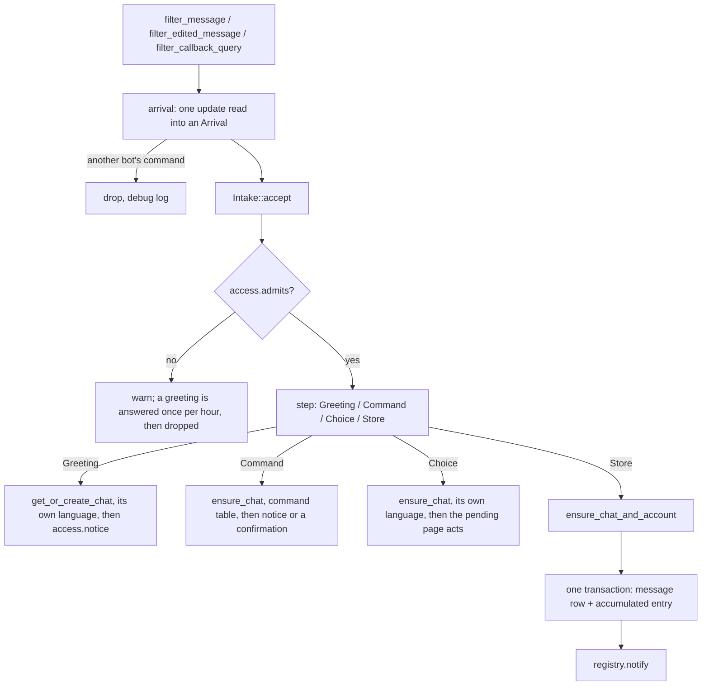

# Platform Integration

> The channel traits, message entry, internal commands, the send chain, file access, supervision and shutdown. Must-read when changing `platform/`.

## Overview

Two platform implementations share the layer: Telegram and TeamSpeak 3. The layer holds one tail per direction and one module per platform's adapter:

- `platform/outbound.rs:OutboundRecorder` — the outbound tail: resolving an internal target to the platform's address, holding the reference to the conversational rules, and recording the row that says the message left.
- `agent/inbound/mod.rs:Intake` — the inbound tail: admission, the command fork, resolving the chat and its account, one-transaction ingest, the doorbell. The platform layer hands it an `Arrival` and nothing else; the tail also holds the `ChannelKey` that owns every chat it creates.
- `platform/host.rs:ChannelContext` — what one supervised run reads (the adapter, the inbound path, the ConversationAgents, the token); `platform/host.rs:ChannelRuntime` pairs it with the supervisor handle the host stops. `domain/vo/chat_address.rs:ChatAddress` carries a chat's optional remote origin and platform id; the chat row names its configured channel by `channel_id`, and the `platform_channel` row carries the key and remote origin.
- `platform/telegram/` — the adapter: teloxide's dispatcher, the update→`Arrival` mapping, the command spelling, the menu, MarkdownV2, the rich-message POST, the send calls, file access, forms and receipts.
- `platform/teamspeak/` — the text-only adapter: one `SyncConnection` event task, the message→`Arrival` mapping, `!` commands, mention addressing, the 1024-byte ceiling, host-copy chunking, and channel file upload for a digest report.

The agent speaks `agent/channel.rs:Channel` and `agent/channel.rs:ChannelAccess`; a platform with buttons also implements `agent/channel.rs:ChannelChoices`, and a platform implements `platform/adapter.rs:ChannelAdapter`, which only this layer names.

## Design

### The channel traits

`agent/channel.rs:Channel` is what the platform layer implements for one configured channel: its key (the storage spelling, prepared once where the channel is built), its profile, and the calls that act on a chat. The agent holds it through `agent/channel.rs:ChannelHandle`, which binds the chat that agent runs in — bound once where the agent is created (`agent/process/registry.rs:AgentRegistry::spawn`) — so a send, a typing indicator or a platform file never re-state which chat they mean, and a verb that takes no chat acts on the channel itself. `agent/channel.rs:ChannelCapabilities` is what that channel declares about itself, and the send tool derives its whole advertised surface from it, so a platform is never asked for what it cannot do (`docs/topics/tools.md`).

`agent/channel.rs:ChannelAccess` is the inbound half: `admits` (whether a chat address may use this channel, in the platform's own id spelling and server scope), `private_chat_external_id` (the address a private message to one sender goes to, because a sender id need not be a chat id), `notice` (host copy, never stored), and `notice_document` (the same, as a file — how a digest's report reaches whoever asked for it). A page of buttons is a separate surface, `agent/channel.rs:ChannelChoices`: `ask` puts a question with buttons out, `edit_choice` rewrites that same message into the next page, `answer_callback` stops the client waiting with nothing, a toast or a popup (`agent/channel.rs:CallbackAnswer`), and `delete_notice` removes the finished page. A platform that cannot show a page does not implement the trait at all; `Intake` holds an optional `ChoiceSurface` that owns both the trait object and its page table, so a channel without buttons allocates neither and never has a dialog entry point to refuse. `platform/adapter.rs:ChannelAdapter` declares only `ChannelAccess` as a supertrait, so whatever this layer hands the tail provably answers the core.

`platform/adapter.rs:ChannelAdapter` is the platform layer's own contract, implemented once per platform; `ChannelAdapter::choice_surface` hands over the adapter's own `ChannelChoices` object when it has one, so `ChannelRuntime::assemble` never pairs an adapter with a foreign page surface. `platform/outbound.rs:OutboundRecorder` implements `Channel` over it, and the inbound tail holds its access half. An adapter therefore reads no domain rows and holds no process container: `platform/telegram/wire/adapter.rs:TelegramAdapter` is its client, its service, its file cache and its own `TelegramConfig`; `platform/teamspeak/adapter.rs:TeamspeakAdapter` holds the connection handle and server origin a generation installs, the channel key that owns its chats, and the allowlist parsed from its section.

### Modules

`platform/host.rs` (`ChannelHost`) owns every channel's lifecycle and their one shutdown deadline; it resolves each `[channel.<name>]` section's platform by its `type` or its name, creates the channel's stop token, and dispatches to that platform's spawner, which hands the adapter back for `platform/host.rs:ChannelRuntime::assemble` to build around. The host also owns one process-wide `ChannelRouter` and one `AgentRegistry`: a Conversation may hold Chats on different platforms, and its agent reaches each Chat's own channel through the router. `agent/inbound/mod.rs` is the inbound tail, `platform/outbound.rs` the outbound one. `agent/process/task_watcher.rs` turns due `scheduled_task` rows into accumulation entries and rings the Conversation; `agent/process/startup_refeed.rs` rings every Conversation under that channel whose accumulation a crash left unconsumed, selected by `platform_channel.channel_key`. Under `telegram/`: assembly and supervision (`builder.rs`), routing (`dispatcher.rs`), the update→arrival mapping and the per-update helpers (`arrival.rs`), the command spelling (`command.rs`), this platform's own config (`config.rs`), sending and the adapter itself (`adapter.rs`, `service.rs`, `reply.rs`, `forms.rs`, `receipt.rs`), the typing indicator (`typing.rs`), the menu (`menu.rs`), and the MarkdownV2 normalizer (`markdown.rs`). Under `teamspeak/`: assembly and supervision (`builder.rs`), the single connection event task and join wait (`connection.rs`), the message→arrival mapping and chat ids (`inbound.rs`), this platform's own config and identity path (`config.rs`), and the text-only adapter (`adapter.rs`).

### Message entry

**Admission first, and the platform answers the id spelling.** `Intake::accept` asks `ChannelAccess::admits` with the chat's address (origin plus platform id), so a platform's allowlist format and server scope stay in its own module. An unauthorized chat is warned about and dropped; only its greeting is answered, and the claim is spent on every unauthorized arrival — one reply per chat per hour is the whole budget.

**Host copy is spoken in one language policy.** A chat we keep is answered in its Conversation's preference (`agent/settings.rs:ConversationSettings::language`), which is why a greeting registers the chat row first; a chat outside the allowlist is answered in the configured default, because it may have no row to read a preference from. The command table resolves the same way, so a chat never hears two languages.

**TeamSpeak reads its three text surfaces into the same `Arrival`.** `platform/teamspeak/inbound.rs:arrival_from_message` maps a server-chat message, a room (TS3 channel) message and a private message to the same neutral shape; a private message is addressed to the bot's own client id, a room id comes from the sender's client state, and a message from the bot itself or a poke is skipped. The sender is keyed by UID, not by the per-connection client id, so an account keeps its history across reconnects; a message whose UID the server did not report is skipped with a debug log. The chat address is the platform's short id (`server`, `channel:<id>`, `client:<uid>`) under a `ChatOrigin` equal to the virtual server's stable UID; the owning configured channel is `chat.channel_id`, and its origin lives on the `platform_channel` row, not in the address. A private message is always `EntryAudience::Agent`; a room or server message is `Agent` only when the configured name or the bot's live nickname appears as a standalone token, and `Bystanders` otherwise. TS3 carries no message id, edit or deletion, so the arrival's external id is a fresh UUID, `change` is always a creation, and `meta` is `null`.

**Persist before the doorbell.** One transaction writes the message row and appends the change to `conversation.pending` — a `message_created` entry for a new message, a `message_edited` one for an edit — and only then is the agent rung (`agent/inbound/mod.rs:Intake::accept` → `domain/service/platform.rs:PlatformService::apply_platform_change`). The doorbell carries nothing: the agent re-reads the accumulation, so there is one copy of the state and no cursor to keep in step. A host operation is answered without a message; a setting change it makes is stored as one `HostAction` entry for the next Turn, and an agent task joins the same accumulation as a command entry (`docs/topics/commands.md`). What the platform derives is who the change was aimed at (`domain::vo::EntryAudience`: a Private chat, a mention of the bot account or a reply to one of its messages — `platform/telegram/inbound/arrival.rs:audience_of`).

**Edits.** `Update::filter_edited_message` shares the arrival path but never the command path: an edit cannot be an invocation (`platform/telegram/inbound/arrival.rs:change_kind` requires the platform's own edit time and errors without it). A message the bot sent itself is skipped — only its sender can edit it. The platform's own signal is the authority: the arrival of `edited_message` *is* the edit, so no comparison of content decides anything; `edit_date` only guards idempotency (`message.edited_at` older than or equal to the stored one is a redelivery and is dropped whole). Content is replaced in place — text and attachment rows — and no earlier wording is kept.

**Deletions are not visible.** Telegram sends no update when a message is deleted in an ordinary chat; only a bot connected to a Telegram Business account gets `deleted_business_messages`, and this implementation has no Business path. A message deleted on the platform therefore stays in the store as it was. Nothing here changes that: the only thing that removes a stored message is a purge of our own, which decides by its own window and never learns why a platform message went.

### Commands

The table, who a slash message belongs to, and the replies are `docs/topics/commands.md`. The platform contributes the adapter: `platform/telegram/inbound/command.rs:classify` splits a slash message and decides whose it is (`arrival.rs` turns that into the arrival's `ArrivalText`, `/start` included), and `platform/telegram/ui/menu.rs:install` pushes the menu from the command table once per channel. TeamSpeak has no menu and no platform-owned commands: `platform/teamspeak/inbound.rs:classify` reads a leading `!` as this channel's command prefix, so `!status --help` and `!purge 7d --yes` run like their slash forms, while `/status` is ordinary text. The tail runs the table (`agent/inbound/mod.rs:Intake::run_command`): a command of ours registers the chat without its sender (a command carries no message, so no account is needed), records the `HostAction` when the command changed a setting, and either answers from host copy through `ChannelAccess::notice` or enqueues the agent task; a name the table does not know is ordinary conversation.

### Host copy and the command menu

Host copy is one vocabulary in `agent/host_copy.rs`: `HostCopy` says what the host says, `HostCopy::render` says it in the Conversation's built-in set — the language replies name a language through `agent/prompt/text.rs:LanguageText::names` — and the inbound tail only hands it to `ChannelAccess::notice`. No reply is assembled from literals at the call site.

The menu follows the **client's** language rather than the Conversation's: `platform/telegram/ui/menu.rs:scopes` pushes the English catalog as the scope without a `language_code` — the fallback a client whose language has no scope of its own reads — plus one `language_code` scope per client code reading another catalog, and that code is a two-letter ISO 639-1 one, the only form Telegram accepts (`platform/telegram/ui/menu.rs:install`). Members of one chat can read menus in different languages, a client in any other language reads English, and a regional variant reads its base language's entry. Names and descriptions come from the command table and the platform's own list.

### Buttons and callbacks

A question with buttons is one message the host puts out and rewrites in place (`ChannelChoices::ask`, `edit_choice`), and each button carries an opaque token the agent layer minted for the page it was drawn on. Telegram delivers a press as its own update kind, so the dispatcher has an `Update::filter_callback_query` branch beside its two message ones, and `platform/telegram/inbound/arrival.rs:callback_arrival` reads it into the same `Arrival` the tail consumes: the chat and the sender come from the message the buttons hang on, the token from the button, and `ArrivalText::Choice` carries the platform's answer handle and that message's id. From there it takes the ordinary path — admission, the chat row, its language — and a press we cannot read at all (a message too old for the bot to see, a button with no data) is dropped with a debug log. Every branch answers the client, though: an unreadable press gets a bare answer, a redrawn page gets nothing at all, because a client that hears nothing waits out its own timeout.

What a token means is the agent layer's (`agent/command/dialog.rs`; each command's page table is beside it, `purge/dialog.rs` and `digest/dialog.rs`): the pages live in memory under one token per button, bound to the chat, one-shot and expiring, and who may press one is the page's own policy (`agent/command/dialog.rs:Audience`) — the person who opened it for a page that acts on them, anybody in the chat for a page that acts on the chat. Nothing about a page is persisted, so a restart leaves every outstanding button stale and the press is told so. TeamSpeak implements only `ChannelAccess`: it has no `ChannelChoices`, so its `Intake` holds no choice surface and no page table. A complete command runs directly, and an incomplete one gets the same missing-argument copy a command line gets, printed as host copy.

### Send chain

`platform/telegram/config.rs:TelegramConfig.rich_message` selects the chain: enabled, a raw HTTP POST to the rich endpoint → MarkdownV2 → plain text; disabled, straight to MarkdownV2 → plain text. The text that left is persisted as the message's text.

The outbound tail resolves the target first (`platform/outbound.rs:OutboundRecorder::send`): the chat's address, and for a `reference` the target message's own platform id plus the excerpt, held to what the conversation allows — the target must be a message of the same chat, an excerpt must be a verbatim part of what it answers and non-empty, and in a one-to-one chat a reference to the newest thing the person said is dropped as the whole conversation already. A target that carries no platform id fails the send with a readable error instead of dropping the reference silently — the model sees the error in the tool result and resends. `topic_id` is validated against the chat before the row is written. The adapter then applies Telegram's own field ceiling, so an excerpt its field cannot hold fails before the platform refuses the whole send.

TeamSpeak has one text call and no field ceiling to fall back from. `platform/teamspeak/adapter.rs:ensure_fits` refuses empty text and any text over 1024 UTF-8 bytes with the byte count and the limit, so the model can shorten it; nothing is truncated or split into several recorded messages. A reference is refused because TS3 has no message id to point at. Host copy is not recorded, so `notice` splits it at UTF-8 boundaries, preferring a newline and then a space, and paces the chunks; a digest report in a room or the server chat is uploaded to that channel's file repository and named in a text line, while a private report is sent as private text chunks and never uploaded.

Every Telegram send arm builds its receipt through `platform/telegram/outbound/receipt.rs:receipt`, so the platform's own id and time are read in one place; TeamSpeak answers with a fresh UUID and the local send time because it has no server message id. After the platform accepted the send, the tail records what left: one message row with the platform's own id and time, the model that answered, and one attachment row per file the receipt carried. The account the row names is the adapter's own profile answer, asked once where the recorder is built. A receipt without a download handle keeps the row's own occurrence id, which no platform handle can collide with.

### Message deletion

`agent/channel.rs:Channel::delete_messages` is best effort by contract: the platform is handed a batch of its own message ids and answers with what went plus one entry per refusal (`platform/adapter.rs:DeleteReport`) instead of failing the call. `platform/telegram/wire/adapter.rs` sends them a hundred at a time, pauses between calls, retries a rate-limited batch after the platform's own `retry_after`, and — when a whole batch is refused, which says nothing about which id was at fault — asks for each id on its own and attributes the refusals. Telegram's own rules still stand: the bot deletes its own messages anywhere, incoming ones only in a private chat, and a group's only with the delete right. That is why a refusal is reported as a count per message rather than turned into a failure: a purge that could not reach one message still finished the rest. A normal TeamSpeak client cannot delete chat messages at all, so `platform/teamspeak/adapter.rs:delete_messages` reports every requested id as failed with that reason; the purge's own store wipe still runs, and the receipt's platform line counts what could not be deleted.

`Channel::forget_cached` drops the local bytes cached for a window's platform files, so a purged attachment is not left behind in the download cache. Neither verb records anything: a message row goes when the purge's own transaction removes it, and the platform never learns what our store holds.

### The typing indicator

The indicator is decoration the platform owns. The agent asks for one where a run composes a reply and holds the guard for as long as the run lives — a Turn does, a wrap-up does not — and dropping the guard ends what the platform started (`agent/channel.rs:TypingGuard`). What keeps it alive between those two points is the platform's own fact — a repeat on its own cadence, one call that expires by itself, an explicit stop — so the cadence and the stop live in that platform's module, in its own constant and its `Drop` (`platform/telegram/outbound/typing.rs:TelegramTyping`). Nothing declares whether a platform shows an indicator at all: it answers with a guard or with `None`. TeamSpeak has no indicator, so `TeamspeakAdapter::start_typing` answers `None`.

### Media analysis and attachment rendering

The platform resolves one file handle to its bytes or its URL (`platform/telegram/outbound/service.rs:TelegramFiles` behind `agent/channel.rs:Channel`'s `download_file`/`file_url`) and stops there: which parser reads a file, which payload it needs and where the result is cached belongs to `agent/multimodal/analysis.rs:MediaResolver`/`MediaAnalyzer`, shared with the local-file and URL sources the `read` tool serves. The attachment row decides the parser (its kind, or the file name for a document) and the perception subject; audio needs bytes from the FileCache, video goes by file URL, and an image downloads only when the active model takes native image input — otherwise it goes by URL to the analyzer. That cache is a download shortcut, not storage: entries not written for a week are swept on a write cadence (`util/cache.rs:FileCache::sweep`), so a deployment's disk does not grow with every attachment it has ever read. The codec an audio or video model is told about is the platform's own media type when the update carried one (`domain/vo/content/attachment.rs:AttachmentMeta::media_codec`, filled from `mime_type`), and the kind's default only when it did not. A sticker is sniffed first and errors out when its bytes are not an image a vision model can read (animated `.tgs`, video-sticker WebM). Rendering gives each attachment an `<attachment>` element with the base transcription (`focus = N…`).

TeamSpeak text carries no attachments in either direction. `platform/teamspeak/adapter.rs` declares no form beyond text, and `download_file`/`file_url` return a readable error; an agent in a room or private chat therefore never sees an attachment row it could read.

### Supervision and restart

Each platform supervises its own generation, with every task held by a `platform/task.rs:TaskGuard` so the generation that owns it aborts it when it ends. Telegram's is a dispatcher plus the scheduled-task watcher; TeamSpeak's is one `SyncConnection` event task, an arrival dispatcher, and the watcher. Any exit other than a cancellation restarts after a backoff of 1 s doubling to a 60 s cap, reset by a generation that lived 60 s. Only the generation's tasks are replaced, so a restart keeps what outlives it: the process-wide `AgentRegistry`'s live ConversationAgents, and the channel's one inbound tail with the period it has already answered an unauthorized chat in (`platform/host.rs:ChannelContext`). Stopping a generation shuts its `ShutdownToken` down before aborting at 5 s: cancelling an in-flight GetUpdates long poll would surface a spurious error.

TeamSpeak's event task is the only owner of the connection: events, outgoing commands and shutdown meet in one `select!`, and arrivals leave over an **unbounded** queue to a dispatcher that calls the intake. A bounded queue would let the event task block on a full queue while the dispatcher blocks on the send that only the event task can service — a deadlock. The connection is opened per generation but the identity is loaded or created once at startup; a down server therefore fails the generation into backoff instead of holding HAI's startup, while a malformed identity file fails startup. `wait_until_joined` holds the generation until the server reports the bot's own client; the event task buffers arrivals in the unbounded queue until then, and the arrival dispatcher, scheduled-task watcher and startup re-feed start only after the origin is installed, so nothing is admitted or sent into a connection that is not ready. Shutdown disconnects, then drains the event stream for at most 3 s; the dispatcher is given 5 s to finish what it took.

### Shutdown orchestration

`bootstrap.rs:serve` is the sole orchestrator: signal → cancel every channel's token → supervisors and registries joined against one deadline → event bus flushed. The cancel comes first because the token cascade is what starts each subsystem's shutdown, and joining only afterwards lets the whole stop finish inside one shared deadline instead of stacking per-subsystem windows.

- **Telegram dispatcher** — stops polling, discarding the in-flight GetUpdates.
- **TeamSpeak event task** — sends its disconnect, drains the event stream for at most 3 s, then its handle is dropped; the arrival dispatcher drains until its sender is gone, and a dispatcher still running at 5 s is aborted.
- **ConversationAgent** (`agent/process/registry.rs:AgentRegistry::drain`) — Idle takes the signal at once; a Busy run is cut by the same token, so it ends without consuming anything and the agent exits from Idle. Queued events are neither decided nor dispatched, and a pending chapter wrap-up waits for the next run's idle tick (`docs/topics/chat-agent.md`).
- **event bus** — `agent/events/bus.rs:AgentEventBus::flush` persists what is left.
- **abandonment** — a missed deadline is warned about and dropped; `ChannelHost` `Drop` cancels and aborts.

## Boundaries

- Two platforms: `domain/model/account.rs:Platform` has `Telegram` and `Teamspeak`; the store keeps the platform's own spelling, and no platform crate type crosses into `domain` or `agent`.
- The platform reads its wire format into the neutral shape (an `Arrival` on the way in, a `SentMessage` receipt on the way out) and derives only who a change was aimed at — it never interprets content.
- The arrival path adds no error handling of its own; the persistence it feeds is what can fail.

## Trade-offs and Reasons

- **Rich messages are opt-in** — the rich endpoint is not in teloxide, so that path is a hand-rolled HTTP POST gated by `TelegramConfig.rich_message`.
- **MarkdownV2 is preprocessed, not escaped wholesale** — `platform/telegram/outbound/markdown.rs:markdown_v2` keeps paired entities and escapes the rest; the price is a normalizer that must track Telegram's entity rules.
- **Persist before the doorbell** — the change is durable in the accumulation before the agent hears about it, so a crash costs a doorbell, never a change; the price is one read of the accumulation per arrival.
- **The reply rules are shared, the field ceiling is not** — which reference may go out is conversation, so it lives in `platform/outbound.rs`; how long a quote Telegram accepts is its own wire fact, so it lives in `platform/telegram/outbound/reply.rs`. A platform with a different ceiling enforces its own.
- **TeamSpeak is text only and refuses overlong agent replies** — its connection carries no audio and its chat no attachments, so the forms and file verbs answer for a narrower surface. A reply over 1024 UTF-8 bytes fails with the count instead of being truncated or split, because a split would make one answer several stored messages; host copy is not recorded, so it may be chunked.
- **A TeamSpeak digest is a file where sharing is intended and text where it is not** — a room or server report uploads to that channel's file repository and sends a path line, while `--to me` sends private text chunks and never uploads, because a channel repository is visible to the room.

## Pitfalls / common mistakes

- **Unauthorized chats are silent** — only a greeting is answered, once per hour per chat; the rest is dropped after a warn log. An empty `allowed_chat_ids` rejects every chat (`platform/telegram/config.rs:TelegramConfig::parse` warns at startup). TeamSpeak has no greeting convention, so an unauthorized TS3 chat is always silent; an absent `allowed-chat-ids` admits every chat, while a present empty list rejects all.
- **`platform/telegram/outbound/markdown.rs:markdown_v2` guarantees a parseable message** — paired entities survive and everything else is escaped, so the fallback fires only on network or permission failures.
- **Mention offsets are UTF-16** — `platform/telegram/inbound/arrival.rs:is_mentioning_user` re-encodes through `platform/telegram/inbound/arrival.rs:check_entities` before slicing, because Telegram counts UTF-16 code units; indexing by `char` misaligns and can panic.
- **A reply to the bot's own message counts as a mention** (`platform/telegram/inbound/arrival.rs:is_reply_to_bot`), with no `@` needed.
- **Keep teloxide's `enable_ctrlc_handler` off** — it is a second SIGINT consumer that cancels the in-flight GetUpdates mid-connect, which the default error handler logs as an ERROR.
- **An attachment is addressed by its occurrence id** (`agent/tools/read/media.rs:Read::read_attachment` → `agent/multimodal/analysis.rs:MediaResolver::attachment` → `MessageService::attachment_by_id`), a primary-key lookup on `attachment.id`; the id is what `<attachment id="…">` renders and what the model hands back.
- **TeamSpeak access defaults open** — unlike Telegram, a section with no `allowed-chat-ids` admits every chat; a present list is exact and a present empty list rejects everything (`platform/teamspeak/config.rs:TeamspeakConfig::parse` warns once). Anyone admitted can run a purge; it wipes the whole Conversation, and a TS3 client cannot remove the chat's messages.
- **A TeamSpeak mention is a standalone token** — `platform/teamspeak/inbound.rs:mentions` accepts `hai`, `@hai`, `Hai's` and `say hai`, but not `haiku` or `hai你好`; the configured name and the live nickname are both candidates, so an administrator's rename does not break addressing.
- **One TeamSpeak identity per section** — the default identity file is `<data_dir>/teamspeak/<key>.json`; two sections sharing one file are duplicate clones to the server, so the supervisor backs off and the log carries the vendor error. A malformed identity file fails startup and is never overwritten.
- **TeamSpeak text needs its own permission** — a room message needs `b_client_channel_textmessage_send`, and server-wide chat needs `b_client_server_textmessage_send` on the bot's server group. `sendtextmessage` has no acknowledgement, so a missing permission leaves the stored assistant row with no client seeing it; grant the permission or have the person write in a room instead.

## Evolution Direction

Another platform follows the checklist in `docs/architecture.md`: a new submodule under `platform/` implementing `ChannelAdapter` with its own config, one arm in `ChannelHost::spawn_all`, and one variant in `domain/model/account.rs:Platform`. Its `[channel.<name>]` section may set `default-conversation-scope`; the host supplies the platform default when it is absent.
