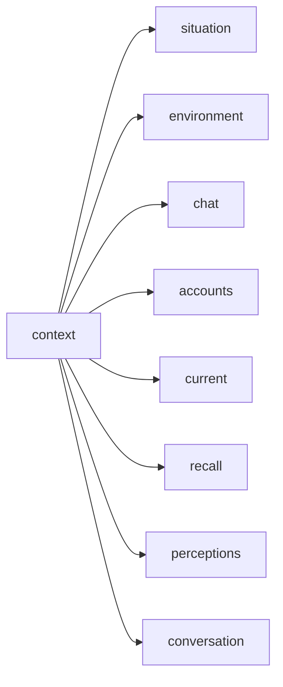

# Prompt rendering

> System prompt assembly, context XML rendering, personality and skills injection. Required reading when changing `agent/prompt/context/`, `agent/prompt/role/`, `agent/prompt/layers.rs` or `agentcore/skills/`. Terms: docs/CONTEXT.md; layering: docs/architecture.md.

## Overview

A Turn's LLM call gets two prompt inputs: a **system prompt**, assembled by `agent/prompt/role/default/prompt.rs:SystemPromptBuilder` from the behavioral layers (their override chain resolved once per process) plus the chat's language (resolved once per Turn), and the **context XML** — the Turn's first user message, rebuilt each Turn by the Node engine of `agentcore/render` (`agentcore/render/mod.rs:render_xml`). Within a Turn the system prompt is byte-identical; the context XML carries what is new.

## Design

### System prompt assembly

Sections are appended in this order — `SYSTEM_PROMPT` → `# Character` → `agents` → `# Environment` → `# Private chat` / `# Group chat` → `# Language` → `skills` — and joined by a `\n----------------\n` rule, each section's content trimmed; a blank section is dropped, and a headed one renders as `{heading}\n\n{content}`. `SYSTEM_PROMPT` is the platform and tool-interface contract and is deliberately not configurable; the chat-type section is `group` or `private`, heading-less for a Channel. Every heading is English, because headings are prompt structure rather than voice.

`# Environment` is a built-in block rather than a configurable layer (`agent/prompt/layers.rs:environment`, English-only) and it is one sentence: `[sandbox] enabled` picks between `You act through a sandbox: a container, not the machine you run on.` and `You act directly on the machine you run on.` It names the environment and stops — the model can look at the tree it got, so what a tool's own caller must know stays in that tool's description.

`soul`, `agents`, `group`, `private` and the separately appended `wrap-up` resolve once at startup (`agent/prompt/layers.rs:resolve`, one `Layer` variant per layer carrying its override file, `[prompt]` field and built-in text) from `.hai/<KEY>.md` > `[prompt] <key>` > the built-in default, blank values falling through — so an edit takes effect only after a restart; a file that exists but cannot be read fails startup rather than silently falling through (`agent/prompt/layers.rs:override_file`). Skills share that lifecycle.

### Layer catalogs and the chat's language

The built-in `soul` and `group` layers each exist twice: a Chinese catalog and an English one. The `private` layer ships no built-in text — a private chat renders no chat-type section, and `.hai/PRIVATE.md` or `[prompt] private` is how an operator adds one. `agentcore/language/mod.rs:Language::text_catalog` picks between them — **Chinese reads the Chinese catalog and every other language reads the English one** (`docs/CONTEXT.md` "text catalog"), so adding a language is one enum variant, its two display names and its client code. Text that exists once per catalog is held as `agentcore/language/catalog.rs:PerCatalog<T>` — every literal names both fields, so adding a catalog stops compiling at each site — and text that takes arguments is held as `PerCatalog<fn(..) -> String>`, selected by `PerCatalog::get` and then called. The boundary that holds the chat's language resolves `Language::text_catalog` once and everything below it takes `TextCatalog`: a catalog-level accessor never takes a `Language`, so a text composed of another — a wake's `describe` rendering a command's `instruction` — hands the same catalog down instead of re-deriving it. `TextCatalog` iterates, and a test pins that every catalog is one some language reads, because a catalog no language maps to is text no chat can reach. A language's name travels as the typed `agentcore/language/mod.rs:LanguageName`. A regional variant (`en-gb`, a future `zh-tw`) sits on its base language's catalog the same way, and what it changes is the statement below rather than the prose; it also has no client code of its own — `agentcore/language/mod.rs:Language::client_code` takes the tag's first segment, so a platform matching a client by code serves it its base language's (`docs/topics/platform.md`). The language itself is one aspect of a chat (`agentcore/language/mod.rs:Language`, resolved as `chat preference ?? cfg.agent.language`), chosen once per Turn and carried on `TurnContext`; the chat preference is written by `/lang` (`docs/topics/platform.md`).

The built-in `agents` and `wrap-up` layers carry one text every catalog reads instead (`agent/prompt/layers.rs:AGENTS` and `WRAPUP`, both fields the same text): operational instructions and the retention pass are machinery, not voice — the reply's language comes from the soul and chat-type layers. One exception, and it is the report rather than a reply: `/digest --lang` names the language of the one report that pass writes, so that run alone reads the named catalog, states that native language, and tells the pass in the situation what language to write in (`agent/command/digest/prompt.rs:task`) while the pages around it stay in the chat's own. The `# Environment` block is the same kind of text, and English-only for the same reason.

The `# Language` section states it as identity — `你的母语是中文。` / `Your native language is Japanese.` — and stops there. A character with a native language still translates, practises a language or quotes someone when asked; writing those cases out as exceptions, or forbidding mixed language, would be spelling out judgments the model already makes.

An operator override (`.hai/<LAYER>.md`, `[prompt] <key>`) is one text and serves every language: whoever writes it has decided what it says.

### Where a rule lives

Layer text is behavioral surface, not documentation, and the same logic lives in exactly one place: a line the layer does not need costs tokens and gives the model something to act on.

- **Tool descriptions** carry only what the JSON schema cannot express — the capability, the format contract and the effect; mutual-exclusion guidance works from one location only and belongs there alone.
- **Behavioral preferences** (tone) live in the configurable `agents` layer, never in a tool description; voice and manner in `soul`; what the room is like in the chat-type layer; how much a message covers, in `SYSTEM_PROMPT`.
- Delete-test for a candidate tool-description line: without it, would the tool be used wrongly? Yes → the description; no → `agents`.

**The frame over the voice.** `SYSTEM_PROMPT` and the `agents` layer set what a turn *is* — the character is the same one across turns, everything marked `own` is its own speech, and a turn is noticing what just happened rather than producing output — while `soul` only colours how it speaks. The frame decides whether the model carries itself forward or re-derives a fresh reply each turn; a persona cannot repair a frame that reads every wake as a production task.

**Fit, not sufficiency, sets a turn's size.** Nothing has to be complete: what a message leaves unsaid is not owed to anyone, so an exchange ending on one line is finished rather than truncated; what the person already knows is not explained back to them, and where their knowledge ends is theirs to show rather than the agent's to assume. What the agent says is its own read of the matter rather than a survey of it, and sizing a message by what the other person needs instead makes anything the agent knows a great deal about come back as a report; the latest thing that settles it is the whole of it — not the working behind it, not the advice it implies — and what a search turned up on the way stays where it was found.

**A layer states facts, not permissions.** The chat-type layer describes the room and the agent's place in it rather than licensing speech: what goes on, that it passes between the others, that what is said belongs to whoever it was said to, and that the agent's own default is to listen. A line it speaks clears a threshold — something that actually got it, not something it happened to read or know — where a licence ("when your name comes up you are there", "you can pick it up too") reads as a switch, and once tripped it makes a remark out of whatever it can add to. The persona carries the other half, as manners rather than as sloth: not making yourself felt, knowing the occasion and where to stop, leaving room, leaving a line nobody picked up where it landed, and treating a spoken line as something its speaker answers for — checked facts, stated uncertainty, and a remark that can be taken as true. A habit stays in the persona ("saying the same thing twice bores you before it bores anyone else") rather than becoming a rule about speaking.

**An individual, not a responder.** A message is what the agent has to say rather than an answer to a question, and a wake that carries no question — scheduled, self-scheduled through `schedule`, or a heat dispatch — is the same kind of turn as an addressed message. The frame says so where the turn starts: `SYSTEM_PROMPT` has what wakes the agent as something that happened rather than a prompt that arrived to be answered, and has most turns end with nothing said; `agents` keeps letting it pass a full turn rather than a failure to act. Wording that makes every turn look like a query turns the agent into a responder, whatever the persona says. A question is the agent's own move — it asks because it wants the difference settled — so `agents` carries the multi-reading judgment rather than a permission to ask.

Prompts give judgment material, not compliance clauses — no quotas, no receipts — and the mechanism never makes a decision the agent cannot see.

### Context XML rendering

`agent/prompt/context/builder.rs:build_prompt` renders one `<context>` root through `agent/prompt/context/sections/context.rs:render_main_context`; children come in this order, and an empty section is dropped.

The first-turn children are the chapter's opening state, rendered once: the bot's identity, the chat and its participants, the agent's own marks (open topics, stale past `topic_idle_hours` and carrying `need-close`, plus pinned memories) and the system's recall from this Turn's window text, excluding what `current` already carries (`agent/prompt/context/load/recall.rs:chapter_recall`). The agent mutates some of that mid-chapter — the `topic` and `memory` tools close a topic or pin a memory — and those changes reach the model through the tool results it already holds, not by re-rendering the block; the opening state refreshes with the next chapter. Every Turn renders the situation; the rest of the render adds the current time.

`<accounts>` is ordered by account id (`agent/prompt/context/load/chat.rs:collect_accounts`): the opening state of the same chat must render the same prompt, and the order a hash map happened to produce would not.

**Accumulation rule.** Rendering appends to `context_messages`, so every item must appear exactly once there; `agent/prompt/context/render_context.rs:RenderContextData`'s `first_turn` is the switch.

**First turn means chapter initial state** — `agent/chat/conversation.rs:Conversation::is_first_render()` is `turn_count == 0`, not "a fresh agent" or "no context messages": a chapter opened by a wrap-up summary already holds that message and is still its first render, and a failed Turn never advances `turn_count` (docs/topics/chat-agent.md).

**Situation-only branch.** With nothing gathered on a non-first turn, `build_prompt` returns a `<context>` whose only child is the situation section (`agent/prompt/context/sections/context.rs:render_situation_only`): a scheduled task or a command has no message of its own, so this is the only place its instruction can travel. An empty prompt would leave the model with neither instruction nor input. A pass that must not read the conversation at all renders the same context with the message list dropped and nothing else — `agent/prompt/context/sections/context.rs:render_context_for_digest` — which is what a digest's prompt is built from: it reads the chat's record with its own tools or not at all.

### Personality (soul)

The section is `You are {name}.\n{soul}` under the `# Character` heading, `config/schema.rs:PersonalityConfig.name` feeding the name. `soul` is the identity and voice body — one piece of free-form prose, no structured parsing. Prose rather than a rule list, because a prompt's shape leaks into the reply's shape: a bullet list asking for a chat register reads as two conflicting instructions. The reply's own shape rides on the same reasoning — a formatting rule against bullet lists is itself a list — so `soul` says typing is typing instead.

### The wrap-up layer

`.hai/WRAPUP.md` > `[prompt] wrap-up` > `agent/prompt/layers.rs:WRAPUP` is its own layer, one English text appended as a user message in the wrap-up pass rather than rendered into the system prompt; the pass reuses the Default system prompt byte-identically (`agent/prompt/role/mod.rs:AgentRole::spec`), so the provider cache survives it. A structured extraction task, it stays detailed where the conversational layers stay short. The layer keeps the pass's two channels apart: the retention summary is the pass's text output (the next chapter's opening), while `memory` files the stretch's standalone facts — the summary is never one of them.

### The digest contract

A digest pass carries its own contract and the environment, skills and language layers, but none of the conversational ones — no soul layer, no agency layer and no chat-type rules, because it is writing a report rather than speaking in the chat. It also takes no Default interface text: it rejects every tool that is not only-read, `send_message` included, and its report is the pass's response text. `agent/prompt/role/digest.rs:CONTRACT` therefore replaces the first block of the system prompt through `agent/prompt/role/default/prompt.rs:SystemPromptBuilder::contract`, while the wrap-up above keeps the Default text and appends its layer as a message. The two rules cannot both hold in one prompt — "only `send_message` reaches the chat" would leave the digest with no output channel — so the pass whose output is the response text says so.

### Skills injection

`agentcore/skills/manager.rs:SkillManager::discovery_prompt` emits a `## Skills` section when at least one skill is discoverable: one entry per skill plus the instruction to load a matching one with `read skill://<name>`. `discoverable_skills` excludes skills whose front matter sets `disable-model-invocation`, and `read`'s description mentions `skill://` only while skills exist. Front matter is strict about top-level keys — `name`, `description`, `license`, `compatibility`, `metadata`, `allowed-tools` — so a SKILL.md carrying an unknown one fails to parse and is skipped with a warning (`agentcore/skills/manager.rs:SkillManager::load_dir`); custom properties belong under `metadata`.

## Boundaries

- Node shapes and field lists are code facts; read `agent/prompt/context/sections/`.

## Trade-offs and Reasons

- **WrapUp reuses the Default prompt and tool surface** rather than a minimal executor: "cannot speak, cannot skip" is enforced at runtime instead of through a narrowed schema (`RoleSpec::rejects`).
- **Chapter-opening injection rather than per-Turn retrieval**: the model gets an index of what it knows and calls `recall` itself afterwards.

## Pitfalls / common mistakes

- **Register instructions decay over a long chapter**: the prompt is fixed per Turn while the chapter grows, and nothing re-injects a style reminder mid-chapter.
- **Two rules that cancel cost more than either is worth**: the model reconciles them itself, obeying each rule nominally while producing the wrong shape.
- **An example is copied, not just read**: a prompt sample, a doc snippet or a test fixture quoting a real conversation ships that conversation to every deployment — examples are invented.
- **Repetition is a frame problem, not a thin persona**: a frame that reads each wake as fresh output makes the model re-derive the same reply and restate it, and its own prior turns in the context reinforce the pattern; continuity in the frame is the lever, not another persona line.
- **`agentcore/render/elements.rs:Node::is_empty` means no children *and* no attributes**, so an attribute-only node such as `<chat …/>` counts as content and is kept.
- **The divider is the batch, not a stored flag**: `RenderContextData::new_message_ids` holds the message ids this Turn's accumulation changed (`agent/prompt/context/sections/message.rs:conversation_element`), and the `separator` is rendered at the first of them — keep the single-divider convention. A message renders `edited_at="…"` once the platform has edited it, and a reference whose sender chose an excerpt renders that excerpt as a `<quote>` child; neither is a message of its own.

## Evolution Direction

- **Per-tool text carrier**: a tool description that outgrows roughly ten lines, or that needs a table or a worked example, should move into its own prompt carrier — none exists today, because current tool syntax does not need one.
