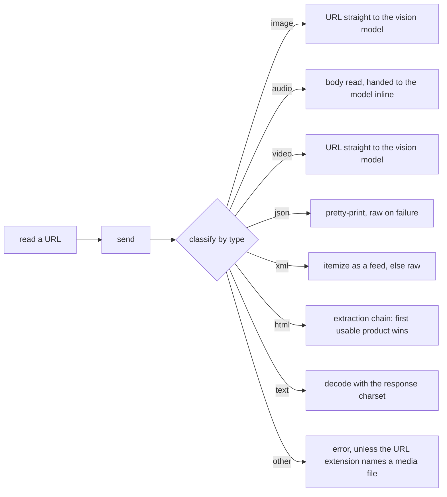

# Tool layer

> The tool contract, the surface per AgentRole, the Step loop, MCP, the sandbox, multimodal perception and networking. Read before changing `agent/tools/`, `agent/prompt/role/`, `agent/multimodal/`, `agent/web/`, `agentcore/mcp.rs`, `agent/run/agent_loop.rs` or `agent/environment/sandbox/`.

## Overview

A tool is how the agent acts. `agentcore/tool/mod.rs:AgentTool` is a name, a description, an optional JSON schema, `execute(Value)`, and four metadata flags: `ends_turn` (the call closes the Turn), `speaks` (the call produces something the user sees), `produces` (the call makes something by spending a model call, without putting it in front of the user, which a chapter wrap-up must not start) and `reads_only` (the call leaves the chat, the workspace and the platform unchanged, which is the surface a digest pass is handed). Role and loop logic reads those flags, never tool names.

## Design

### One tool per resource

Operations on one resource collapse into one tool with a discriminator (`agent/tools/topic.rs:TopicArgs`, `agent/tools/memory.rs:MemoryArgs`, `agent/tools/schedule.rs:ScheduleArgs`). Its schema **must be an object root**: OpenAI-compatible endpoints reject a bare `oneOf` root, and provider normalization degrades a residual root combinator into a field-less schema. Serde's internally-tagged enums emit exactly that root, so op tools are flat objects with an `op` enum.

### Schema normalization

Every schema, MCP `inputSchema` included, passes `agentcore/tool/schema.rs:normalize_root` at one entry point (`agent/run/step_loop/mod.rs:prepare_genai_tools`). A root `$ref` resolves in place, and root combinators merge into one object — properties union, discriminators combined, `required` unioned for `allOf` and intersected for `oneOf`/`anyOf` — so no root combinator survives. A faulty branch is dropped with a warning while the rest still merges; only a root with nothing to merge, or a merge yielding no property at all, becomes an empty object schema.

### Assembly

`agent/run/engine.rs:mounted_tools` is the single assembly entry, run once per chat: `agent/prompt/role/default/mod.rs:tools` builds the built-in surface, the process's MCP tools are appended to it, and `agent/tools/mod.rs:sanitize` filters the result. The set is a chat's, not a role's or a Turn's, because a surface that changed per Turn would invalidate the prompt prefix the provider caches.

| Mounted | Condition |
|---|---|
| `send_message` | always; the Default role's only way to speak, advertising only the kinds the platform and this build can send |
| `generate_image` | image generation is configured |
| `read` | always, advertising only the sources this process supports (its source list follows the configured capabilities) |
| `web_search` | a usable provider exists; otherwise removed rather than mounted to always fail |
| `search_knowledge_base` | the feature is on; an empty corpus still mounts it |
| MCP tools | the process has any; part of the chat's mounted set, so the wrap-up pass shares them (a wrap-up call is refused by the `produces` flag, not by the surface) |

`agent/tools/mod.rs:sanitize` runs after both assembly points: it drops names in `[tools] disabled` (`docs/topics/config.md`; exact, case-sensitive) and names breaking the provider's naming rule.

### Built-in tools

All implementations live in `agent/tools/`.

| Tool | File | What it does |
|---|---|---|
| `skip` | skip.rs | Ends the Turn |
| `wait` | wait.rs | Waits for a user still typing |
| `send_message` | send/ | Says something: text, a voice message or an existing file; `kind` picks which |
| `generate_image` | send/ | Generates one image into `workspace://generated/`; sends nothing |
| `topic` | topic.rs | Lifecycle ops; `close` ends the span |
| `memory` | memory.rs | record / revise / invalidate / forget / pin |
| `recall` | recall.rs | Chat-scoped memory and topic lookup, fused and reranked |
| `search_knowledge_base` | knowledge.rs | Hybrid retrieval over the global corpus, fused and reranked |
| `read` | read/ | file:// (or a bare path), workspace://, URL (text or media), attachment, skill, topic, memory |
| `web_search` | web.rs | Live-web retrieval |
| `schedule` | schedule.rs | Create, list or cancel wakes |
| `bash` | shell.rs | Runs a shell command |

`send_message` carries the same two optional reply arguments on every kind: `reference`, the internal id of the message the send points at — the id the context shows as `<msg id="N">` — and `quote`, the part of that message being answered, copied verbatim from it. A quote must be a non-empty exact substring of what the context shows as that message's content — its text plus each attachment's caption (`domain/service/message.rs:quoted_content`) — or the send fails with the error the model sees (`platform/outbound.rs:excerpt_is_verbatim`); on top of that each platform enforces its own field ceiling, which for Telegram is 1024 characters (`platform/telegram/outbound/reply.rs:validate_quote`). In a one-to-one chat a reference to the newest message from the person is dropped, since it says nothing the chat does not already show. Both are declared capabilities: a platform that cannot point at a message does not offer them.

`kind` decides the payload, and each platform declares the forms it can send and what each form takes (`agent/channel.rs:ChannelCapabilities`). `content` is the line that goes with the message — the text itself, or what goes with media, stored as the message's text so a context render shows it. `prompt` describes how a voice message should be spoken. `source` is an address — `workspace://<rel>`, `file://<path>`, a bare path, or an `http(s)://` URL — and a local one must be a path the sandbox exposes (`agent/tools/send/media.rs` asks `Sandbox::ensure_readable`, and refuses a file over the platform's declared ceiling instead of reading it); a URL is handed to the platform to fetch. A file's medium follows its content: an image goes as a photo, anything else as a document.

`read` pages what it returns: `offset` (1-based) and `limit` are counted in the unit the result reports, and the unit follows the content — `lines` for text, `chars` for text carrying a line longer than `MAX_LINE_CHARS` (4 KB, `agent/tools/read/paging.rs`), `notes` for a topic archive. One page is bounded by `MAX_WINDOW_LINES`/`MAX_WINDOW_CHARS`, an over-long line is cut and marked, and `next_offset` names where to continue — absent once the page reaches the end.

### Results

A result carries only what the model cannot know: the handles the server assigned (a new `topic_id`, `task_id`, a memory `id`), the decisions the server made (a suppressed duplicate and the near-neighbours that produced it), and the values it normalized. Everything the model just sent is already in its own tool call in the message stream, so echoing it back is pure cost — and a repeating one: results are part of the context state written by `agent/chat/conversation.rs:Conversation::update`, so they are re-sent on every later Step and Turn of the chapter. An op with nothing new to report returns `{"ok":true}` (`agentcore/tool/mod.rs:tool_ok`), which also keeps the `hai log` TOOL panel readable.

`recall` and `search_knowledge_base` take `limit` as the number of results the model keeps; the candidate pool behind it is larger, because a vector leg and a lexical leg are fused and then reranked before the trim (`docs/topics/domain.md`).

### Execution: the Step loop

`agent/run/step_loop/mod.rs:StepLoop::run_tool_calls` runs a Step's calls through `execute_single_tool`, one at a time: tools depend on each other's side effects, and a fixed order keeps a Turn traceable. The wrap-up pass reuses the built-in surface but rejects speaking and turn-ending tools (`agent/prompt/role/mod.rs:RoleSpec::rejects`), so `send_*` and `skip` cannot leak a reply out of a chapter close.

Model text reaches the user only through a tool declaring `speaks`; a Step breaking the contract — text with no call that does not end the Turn — gets one injected violation message, and a second consecutive violation ends the Turn cleanly and drops the text — a Step that keeps the contract resets the count (`agent/prompt/role/default/mod.rs:decide`).

Retries (`agent/run/step_loop/retry.rs:retry_backoff`) cover transient failures only — network-class failures, throttling and gateway statuses, an unparsable success body — at most twice per Step, everything else propagating at once; `[agent] max-steps` bounds a model that keeps calling tools, and the loop says so once when a couple of steps remain (`agent/run/step_loop/mod.rs:BUDGET_NOTICE_AT`) — a notice that lives in the run only, dropped from the transcript it leaves (`agent/run/step_loop/mod.rs:StepLoop::transcript`), so a later Turn never reads a spent budget's warning. A call returning the same result three times running earns one nudge (`agent/run/step_loop/mod.rs:StallGuard`), which never blocks it: a tool may legitimately poll.

### Networking

`agent/web/mod.rs:WebService` is assembled once at startup and shared across chats.

**Fetch** — `agent/web/fetch/mod.rs:Fetcher::fetch` sends, classifies, decodes and dispatches under one timeout that also covers a provider step:

`agent/web/fetch/body.rs:Body::of_mime` fixes that shape, and the shape is the semantics: SVG is the one image treated as text, because a vision model usually rejects it. Audio is read into the request because the provider's audio shape carries data and not a URL, while video goes on as a URL for the model to fetch; a response with no media type, or with `application/octet-stream`, is read by the URL's own extension (`agent/web/fetch/mod.rs:Body::of_extension`).

**Extraction** — a chain entered only by HTML: the local extractor and provider steps run in order and the first *usable* product wins (more than a few characters, no unrendered-page markers, not a navigation dump — `agent/web/fetch/quality.rs:usable_text`). Every step producing something but none usable returns the first product with a warning, and nothing produced fails the chain. A provider step asks for the page body rather than query-focused excerpts (`agent/web/provider/table.rs` declares `full_content`, `agent/web/provider/mod.rs:McpClient::fetch_page` merges it in), so a page the local extractor cannot render still yields its text.

**Query constraints** (`agent/web/search/query.rs:Query::parse`) filter results locally while the provider still receives the original query — dimensions AND, values within a dimension OR — relaxing a dimension that filters everything out into a note rather than an empty answer.

**Search** (`agent/web/search/mod.rs:SearchChain::search`) walks the configured order (empty = built-in), takes the first provider with a non-empty result set, and bounds each call by its own timeout; only a total failure errors, carrying every provider's reason.

**Provider table** (`agent/web/provider/table.rs`) declares each provider once (endpoint, transport, fetch and search capabilities, keyless status, environment variable, result cap), so a chain entry is one id. Credentials resolve environment-first (`agent/web/provider/key.rs:resolve_key`) then from config: the hosted pair is keyless on a rate-limited free tier, while the REST provider always needs a key.

**Keys** — `[web]` is the networking block: `fetch.chain` lists extraction engines in order (`local` or a provider id; the default chain is `local` then a provider, and an explicitly empty chain extracts nothing) and `search.chain` lists provider ids for retrieval, falling back to the built-in order when empty; `fetch.timeout-secs` / `fetch.max-bytes` / `fetch.user-agent` and `search.timeout-secs` bound one attempt; and a credential goes in `[web.providers.<id>] api-key` for `parallel`, `exa` or `tavily` (never a `[providers.*]` model endpoint). The environment variable named in the table wins over the config value, and a blank value counts as unconfigured.

### Sandbox

`agent/environment/sandbox/mod.rs:Sandbox` is the environment the agent's tools act on: two variants, chosen per ChatAgent from `[sandbox] enabled`, so no tool carries a mode branch and no tool description states the environment — that block is the system prompt's (`docs/topics/prompting.md`). Besides running a command, it answers where a command runs by default (`command_root`), where the chat's workspace sits on the host (`host_workspace`), and which paths a tool may open (`ensure_readable`).

- **The container is created on the first command and reused**: `agent/environment/sandbox/container.rs:ContainerGuard::create` binds the skill roots and `[sandbox] mounts` read-only at their own paths and the chat's workspace at `/workspace` (writable, and the default working directory), and `ContainerGuard`'s `Drop` removes it synchronously. A command is one `docker exec` running `bash -c`.
- **File access is the host's own filesystem** (`agent/tools/read/local.rs`): `read` opens local paths with `tokio::fs`, asking `Sandbox::ensure_readable` first — a container exposes its workspace and the directories mounted into it (both sides canonicalized, so a symlink cannot walk out of a mount), the host exposes everything, because that is what turning the sandbox off means. A local read therefore cannot reach past what the sandbox exposes, at the price of the container's own paths (its `/etc`, its `/tmp`) being reachable by `bash` alone, where `read` refuses them.
- **The workspace is the one writable place in a container**: `agent/environment/workspace.rs:Workspace::for_chat` names the directory and `Workspace::create` makes it, at assembly, kept across chapters and runs. `workspace://<rel>` resolves through `Sandbox::host_workspace()`, and an absolute path under a container's `/workspace` is re-rooted onto it too (`agent/tools/addressing.rs:Address::local_path`), so both spellings of the model's name one file whatever the directory's real location is.
- **Timeout is a contract**: zero means no deadline, a finite value is clamped to 3600 s, an absent one falls back to `[sandbox] timeout-secs`, and a timeout is always a tool error, never a silent truncation.
- **Truncation is head-and-tail** (`agent/tools/shell.rs:cap_output`): the elided byte count comes back as data, and the marker points the model at redirecting to a file and paging it with `read`.

### Multimodal and the perception cache

`agent/multimodal/mod.rs:MultimodalService` exposes the understanding calls, OCR and speech synthesis; an omitted vision or transcription block delegates to the main model when that provider can read the media, while `[agent.multimodal.*] enabled = false` (or a dedicated role with an empty model) reports unavailable — and without speech the `voice` form is not served, so `send_message` neither advertises nor accepts `kind: "voice"` (`agent/tools/send/mod.rs:served_forms`).

- **The analysis prompts are transcription templates because their reader is a text-only main model**: each states that the description is the reader's only visual or audio input.
- **Two mutually exclusive modes**: without a focus the full transcription, with one a targeted judgment that *replaces* the default analysis.
- **One pipeline serves every source** (`agent/multimodal/analysis.rs:MediaAnalyzer`): the `read` tool resolves a source to a payload and a parser, and the analyzer picks the payload that parser needs, calls the understanding model and writes the perception. A local file is read by content first (`AttachmentParser::from_bytes`: image magic, then container magic) and by its name second; an attachment is read by its kind, or by the file name when the kind is a document; a URL is read by its response type. `read`'s `parser` argument overrides the parser only where the payload stays the same — `ocr` reads an image as raw text — so `Ocr` is never chosen automatically. Inline bytes (a local file, URL audio, a downloaded platform file) are bounded by `[agent.multimodal] inline-max-bytes`, refused before the file is read.
- **Perception is a cache keyed by subject, parser and focus** (`domain/service/perception.rs:PerceptionService::upsert`): the subject is a platform handle (`<platform>:<file_unique_id>`, falling back to the download handle) or a normalized URL, and a local file has neither, so it is analyzed on every read. One file is analyzed once per pipeline — the rendered `same_resource_as` points at the attachment that carried the analysis first.

### MCP

`agentcore/mcp.rs:McpManager::from_config` runs the configured stdio servers as subprocesses that die with the process.

- **The surface resolves once, at connect time**, under a listing timeout, and is reused for the process lifetime.
- **Classification is error-first** (`agentcore/mcp.rs:classify_result`): `isError` is read first, so a failed call is never short-circuited into success data by structured content.
- **Every call is bounded** by a timeout, so a wedged server cannot pin a Turn in Busy.

## Boundaries

- No automatic tool retry: a tool's failure is a result the model sees.
- Page text is never cached, and neither is a local file's analysis: only an analysis with a subject (a platform handle or a URL) is.

## Trade-offs and Reasons

- **Merging root combinators instead of rejecting them** keeps third-party MCP variant schemas usable, at the cost of a pass with its own recursion limit; an empty object schema is the last resort, never the first.
- **The chain returns its first product when nothing is usable**: content plus a log line beats an error.
- **`read` and `bash` share one tree rather than one trapdoor**: the workspace and the mounts are the same directories on both sides, so a file `bash` writes is the file `read` opens — while a container's own paths stay `bash`-only, and `read` refuses them instead of quietly opening the host's namesake.

## Pitfalls / common mistakes

- **A tool's role comes from its own metadata, never its name**: a new speaking tool must declare `speaks`, or its output is treated as unsent text.
- **A new op-style tool must be a flat object root**, or it reproduces the `oneOf` root endpoints reject.
- **A result echoing its own arguments proves nothing**: the model already sees them in its own tool call, and a missing row already fails the call — while the echo is re-sent on every later Step and Turn of the chapter.
- **Extraction sees only server-rendered HTML**, so a JS-rendered page needs a provider step in the chain.

## Evolution Direction

- **A tool-policy layer**: `read` and `bash` are bounded by prompt policy alone, and separating "may this run" from "which tool should be used" tightens that.
- **Probing same-path `.md` or `llms.txt`** is deferred: content negotiation covers most documentation sites, and a probe belongs only behind a per-host memo.
